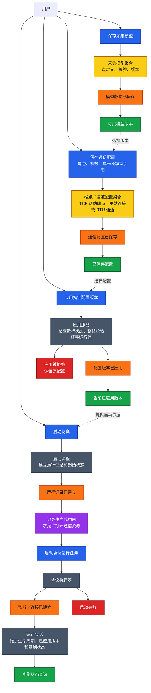
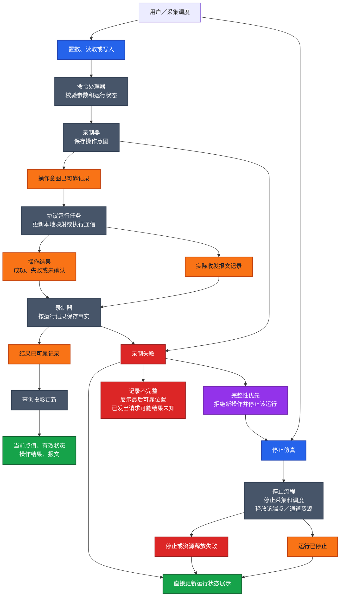
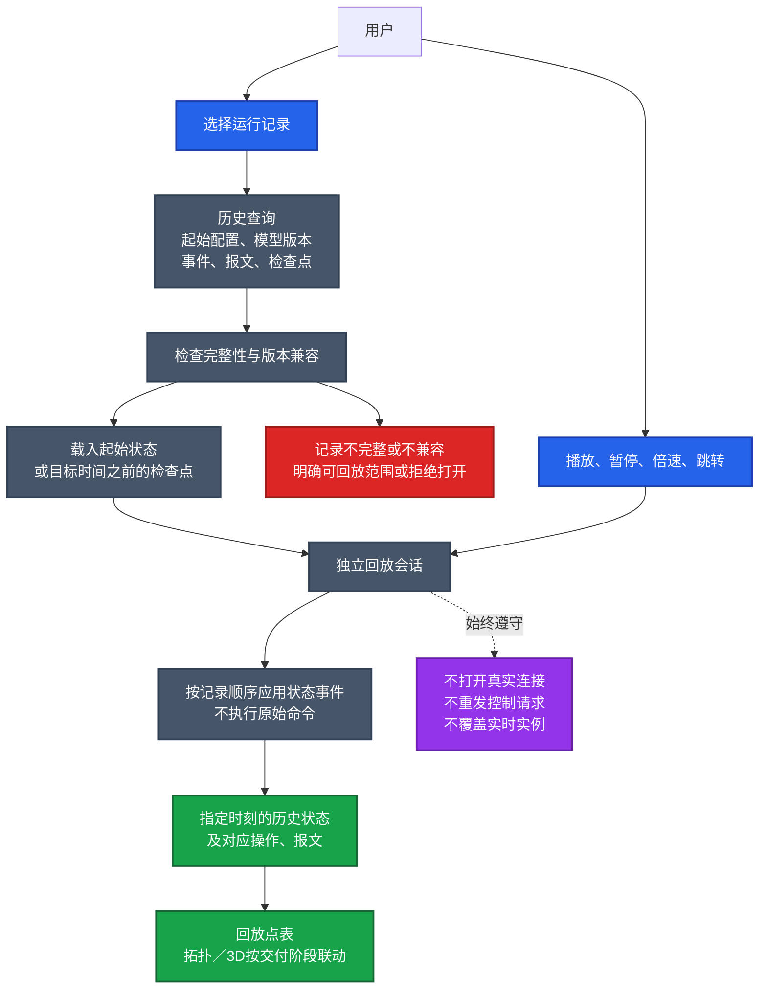

# Modbus 模拟器事件风暴与运行流程

更新日期：2026-10-15。状态：讨论稿，尚未形成实现或验收结论。

关联：[M01 基础模型与架构边界](../plans/modbus-simulator.md#m01-基础模型与架构边界)。

本图分为业务配置与启动、执行与可靠录制、离线回放三个视角。第一张展示业务过程；后两张补充执行与存储协作，不将所有技术组件都当作业务聚合。具体事件格式、事务边界、可靠落盘、失败恢复与线程方案仍需在提案中确定。

图例：蓝色为命令，黄色为聚合，橙色为事件，紫色为自动策略，绿色为查询／展示，灰色为应用或技术组件，红色为故障。

## 1. 配置与启动的业务过程

保存、应用、启动均由用户分别触发，不自动串联。采集模型是一张点表，主从角色使用对应字段；设备关联可选，具体关系见 M01。

## 2. 运行操作、可靠录制与停止

以下以用户置数／主站读写为例。原始报文与执行结果分别记录；请求已发送不等于远端执行成功。

正常停止也要记录停止结果；故障停止不能等待录制恢复才执行，也不能因为最后一条停止事件写不进去而反复触发停机。故障提示必须能绕开已失败的持久化路径显示。

一条运行记录覆盖一个端点／通道及其下属单元，临时断线和重连不另开记录。外部主站请求也纳入录制，但不能在收到请求前预先记录其意图，具体收发与落盘顺序需单独细化。

## 3. 离线回放

回放消费已保存的事实，不重新执行历史命令。

