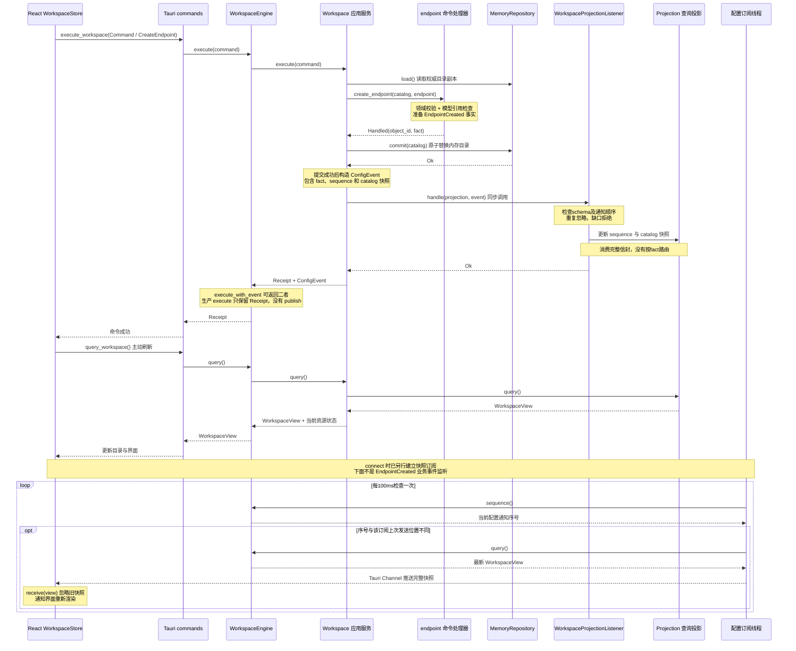
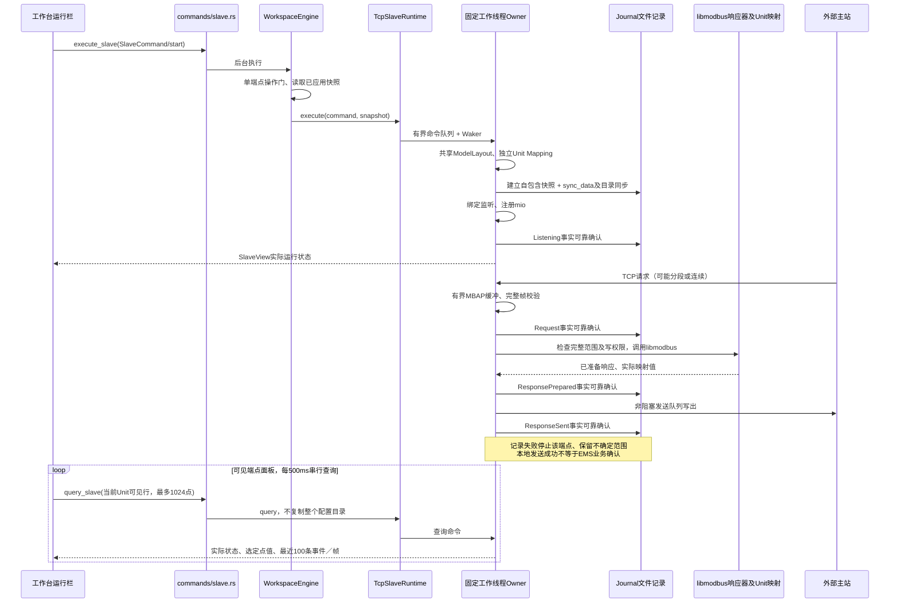
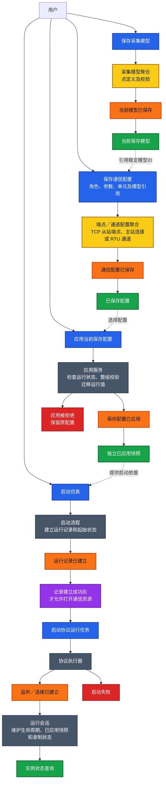
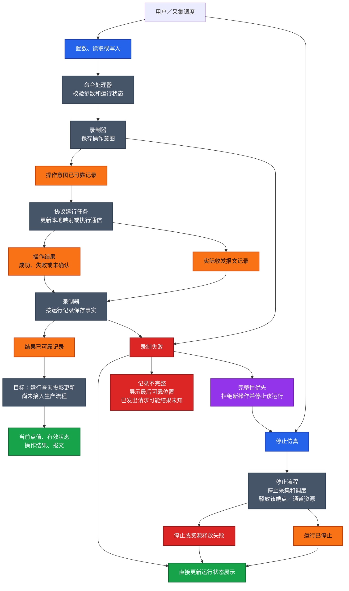
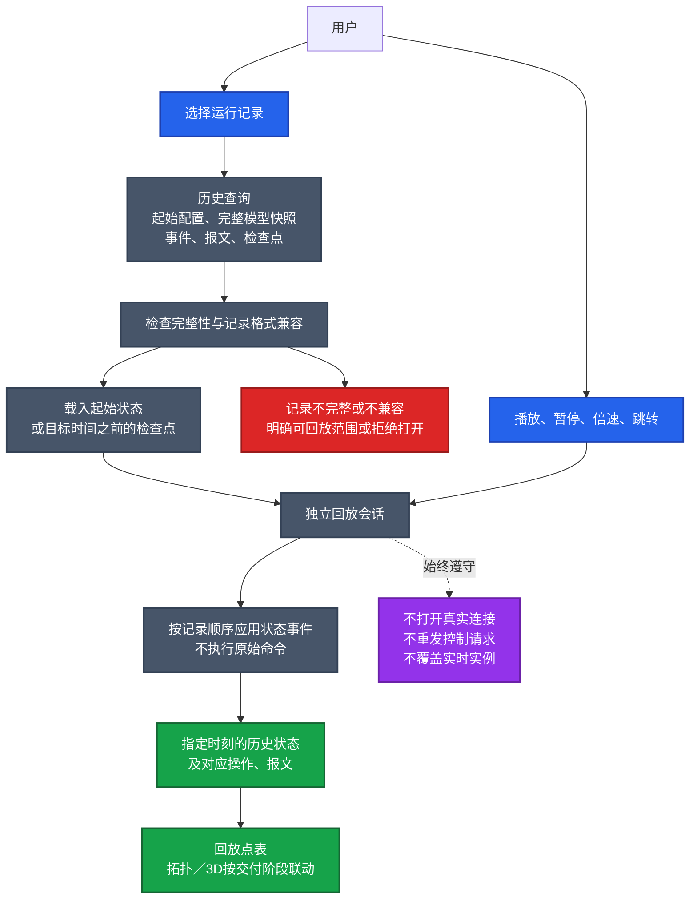
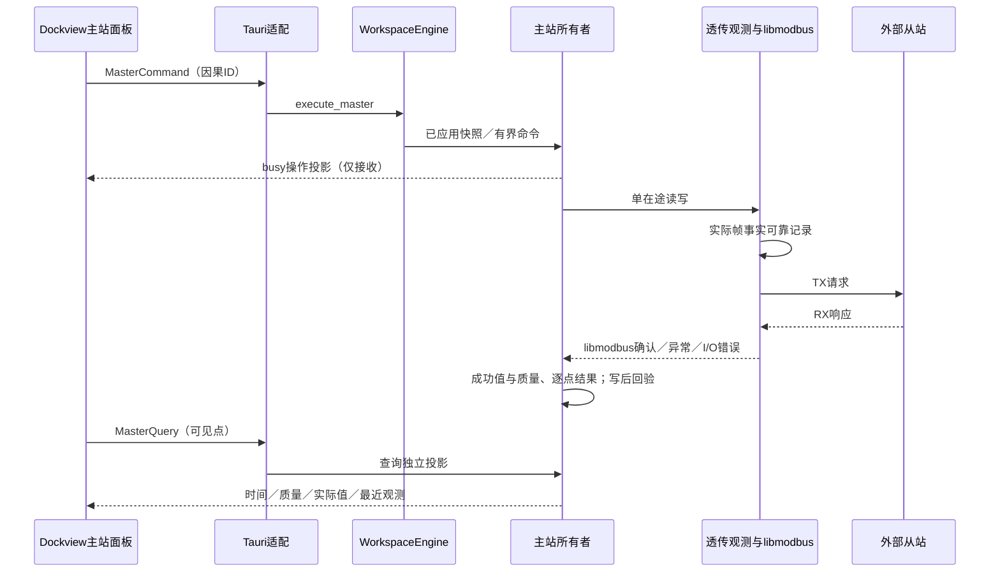
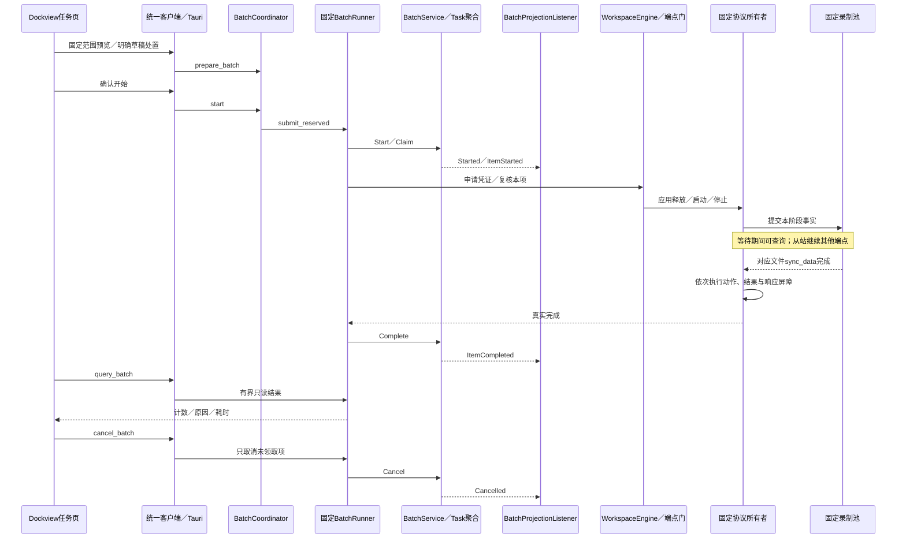

# Modbus 模拟器事件风暴与运行流程

更新日期：2026-10-18。原图始于2026-10-15；本次将当前代码流程与目标业务流程分开标明。第0节与0B节对应现有实现，第1–3节是业务设计视角，不能整体当作已接入能力。

关联：[M01 基础模型与架构边界](../plans/modbus-simulator.md#m01-基础模型与架构边界)。

第0节逐步对应服务、命令、提交事件、查询和前端订阅的实际调用。后续三张业务图保留配置与启动、执行与可靠录制、离线回放三个设计视角；事件后的连线表达业务先后或目标协作，不表示已存在事件总线、自动策略监听器或数据库。TCP从站已增加独立运行命令、固定线程执行器和可靠文件记录，见0B节；RTU、通用业务事件分发及可用回放仍由后续提案实施。

图例：蓝色为命令，黄色为聚合，橙色为事件，紫色为自动策略，绿色为查询／展示，灰色为应用或技术组件，红色为故障。

## 0. 当前代码：新建模拟器的命令、查询与通知

此图是当前成功路径的调用时序。前置条件：用户已选择保存过的模型，命令携带完整端点及首个Unit。保存只写本次会话的MemoryRepository，不启动通信。

校验或commit失败时，不返回成功ConfigEvent，不推进配置通知序号。应用／删除另有资源释放确认边界；释放已确认但提交失败时，停止事实保留，不能由本图的新建路径推断其失败状态。

### 图中组件对应哪份代码

| 图中职责 | 实际代码 | 当前行为 |
| --- | --- | --- |
| 前端命令入口和主动刷新 | [WorkspaceStore.execute／refresh](../../workbench/src/features/workspace/model.ts) | 构造Command，收到Receipt后主动查询，不依赖后台订阅才能刷新 |
| Tauri命令与查询适配 | [execute_workspace／query_workspace](../../workbench/src-tauri/src/commands/simulator.rs) | 写命令在后台任务执行；读取返回WorkspaceView |
| 线程安全应用入口 | [WorkspaceEngine](../../crates/infrastructure/src/workspace.rs) | execute内部调用execute_with_event，但生产入口只返回Receipt |
| 应用服务 | [Workspace](../../crates/core/src/application/service.rs) | 权威加载、命令分派、原子提交、事件信封和同步投影更新 |
| 命令定义及处理 | [Command／Action](../../crates/core/src/application/commands/mod.rs)、[create_endpoint](../../crates/core/src/application/commands/endpoint.rs) | 命令是写入意图；处理器调用领域规则，准备事务内结果 |
| 已提交配置事件 | [ConfigurationFact／ConfigEvent](../../crates/core/src/application/events/mod.rs) | EndpointCreated表达成功业务事实；没有发布到业务监听器 |
| 权威存储 | [MemoryRepository](../../crates/infrastructure/src/workspace.rs) | 内存整体替换，没有SQLite或其他本地数据库 |
| 查询投影 | [Projection／WorkspaceView](../../crates/core/src/application/queries/mod.rs) | 构造只读查询快照；accept兼容入口委托给同一监听器 |
| 同步事件消费者 | [WorkspaceProjectionListener::handle](../../crates/core/src/application/event_handlers/workspace_projection.rs) | 服务提交后显式调用，按序号复制catalog快照；不按fact路由 |
| 后台快照通知 | [subscribe_workspace](../../workbench/src-tauri/src/commands/subscriptions.rs) | 每100ms检查序号，变化后查询并通过Channel发送最新快照，可合并中间变化 |
| 前端实际监听点 | [channel.onmessage](../../workbench/src/shared/api/workspace.ts)、[WorkspaceStore.connect／receive](../../workbench/src/features/workspace/model.ts) | 监听WorkspaceView消息及本地Store变化，不监听EndpointCreated |

### 当前缺口：具体业务事件尚未分发

目前不存在 `on(EndpointCreated, handler)`、事件分发器或按业务事件注册的监听器。ConfigurationFact已经生成；现有WorkspaceProjectionListener只同步消费信封中的快照，生产入口没有继续分发给其他业务监听器。不能把“已有具体事件类型”写成“已经完成事件发布与监听闭环”。

| 需要区分的动作 | 当前状态 |
| --- | --- |
| 提交成功后生成具体配置事实 | 已接入 |
| 服务同步把事件交给查询投影 | 已接入，通过event_handlers中的同步投影监听器 |
| 前端监听查询快照Channel | 已接入，序号检查后推送 |
| 按EndpointCreated等业务事件注册、发布和调用监听器 | 未接入；监听器职责、失败处理和通知顺序仍待设计 |
| 事件可靠存储、重试和重放 | 未接入；配置事实不能替代可靠运行历史 |

后续如果要求事件监听驱动投影或其他服务，需要先明确哪些处理必须同步完成、哪些允许失败后补做、如何避免重复处理，以及查询何时能看到提交结果，再形成实施任务。本次目录细分已将现有同步消费者独立为event_handlers模块，图同步反映该调用；按具体fact注册及分发的缺口仍保留，不引入消息平台。

## 0B. 当前代码：TCP从站运行（2026-10-18）

本路径使用独立SlaveCommand／SlaveView及SlaveFact，不把运行操作发布成ConfigEvent。既有RunCoordinator仍是通用契约测试；正式TCP路径没有假装装配该泛型协调器，也没有通用事件总线。Journal是SlaveFact的显式同步消费者，文件记录可靠确认后才继续。

本地置数先经ModelLayout.plan_values整批校验，然后记录ValuesIntent、修改映射、记录ValuesCommitted；同一所有者也处理外部写入。恢复指定数据区地址范围／全部点使用已应用初值。前端刷新与提交均不依赖选区：刷新由RuntimeGrid公开视口解析稳定身份；提交由RuntimeDataSource待修改集合归集当前Unit各分类草稿，成功后只清除提交时版本，期间的新编辑继续保留。停止命令在所有者完成当前同步处理后关闭该端点全部客户端及监听；尚未写出的响应明确保留不确定标记。apply／delete先停止并接回实际值，再沿配置分段释放流程执行；成功后清理旧静止映射。

| 职责 | 实际文件 |
| --- | --- |
| 运行命令／查询／事件定义 | [commands/slave.rs](../../crates/core/src/application/commands/slave.rs)、[queries/slave.rs](../../crates/core/src/application/queries/slave.rs)、[events/slave.rs](../../crates/core/src/application/events/slave.rs) |
| 模型地址、权限及批量规划 | [domain/slave.rs](../../crates/core/src/domain/slave.rs) |
| 应用边界及配置协调 | [WorkspaceEngine](../../crates/infrastructure/src/workspace.rs) |
| 运行服务／所有者 | [tcp_slave/mod.rs](../../crates/infrastructure/src/tcp_slave/mod.rs)、[worker.rs](../../crates/infrastructure/src/tcp_slave/worker.rs) |
| Unit映射／可靠事实消费者 | [mapping.rs](../../crates/infrastructure/src/tcp_slave/mapping.rs)、[journal.rs](../../crates/infrastructure/src/tcp_slave/journal.rs) |
| 安全完整帧响应入口 | [responder.rs](../../crates/libmodbus/libmodbus-rs/src/responder.rs) |
| IPC／前端运行入口 | [commands/slave.rs](../../workbench/src-tauri/src/commands/slave.rs)、[SlaveRuntimeControls.tsx](../../workbench/src/features/workspace/SlaveRuntimeControls.tsx) |

规模探测与原生待验边界见[M04记录](../test-records/2026-10-18-m04-tcp-slave.md)。文件记录不等于SQLite配置持久化或已交付历史查看／回放。

## 1. 配置与启动的业务过程（目标视角）

保存、应用、启动均由用户分别触发，不自动串联。采集模型是一张点表，主从角色使用对应字段；设备关联可选。当前配置保存／应用已接入，TCP从站实际启动和文件录制已接入0B节，RTU及其他运行路径仍待实施；本节事件连线是业务关系，实际调用以第0节为准。配置版本管理已于2026-10-16取消，以下改用当前保存内容和独立已应用快照。

## 2. 运行操作、可靠录制与停止（核心契约与目标流程）

以下以用户置数／主站读写为例。RunCoordinator目前只有受控端口测试，工作台未装配生产执行器和可靠Recorder。图中的录制、实际收发及运行查询展示属于目标流程；事件节点之间的箭头不能理解为已注册监听器。原始报文与执行结果分别记录，请求已发送不等于远端执行成功。

正常停止也要记录停止结果；故障停止不能等待录制恢复才执行，也不能因为最后一条停止事件写不进去而反复触发停机。故障提示必须能绕开已失败的持久化路径显示。

一条运行记录覆盖一个端点／通道及其下属单元，临时断线和重连不另开记录。外部主站请求也纳入录制，但不能在收到请求前预先记录其意图，具体收发与落盘顺序需单独细化。

## 3. 离线回放（目标流程）

ReplaySession目前仅有隔离状态重建契约与测试；生产历史读取、可用播放界面、持久化检查点和拓扑／3D联动尚未接入。目标是消费已保存的事实，不重新执行历史命令。

## 图与实现的维护约定

新增或调整服务、命令、查询、事件消费和存储路径时，同时核对第0节时序及代码映射；行为尚未接入的部分继续标为目标／契约，不能仅因目录拆分或类型存在就改为已实现。业务范围变化还需同步实现计划和对应OpenSpec提案。历史验收记录保留原证据边界，本次不关闭M02／M03未验任务。

## M05 TCP主站实际流程（2026-10-19）

事件来自真实所有者与传输路径，经同步投影和可靠文件记录消费；没有引入通用消息总线或配置事件溯源。连接命令接收、协议写入确认、回验一致与设备动作完成是不同语义。应用配置走同端点操作门，先断开并确认释放后原子替换，保持断开，不自动重发控制。

### RTU实际路径（2026-10-19）

沿用上文MasterCommand → WorkspaceEngine → 所有者 → 传输适配 → 实际从站 → MasterFact／查询。RTU适配为`rtu_bridge::RtuConnection`，独占串口由透传线程RAII持有；TX生成的实际帧先可靠记录再准备写出，RX记录实际接收、CRC及短帧，迟到窗口数据明确discarded，不进入下一次成功结果。单Unit协议错误经有界排空继续其他目标，驱动故障才关闭通道并在采集意图存在时重开。诊断走Diagnose手动命令及相同有界队列，拒绝改变通信状态的子功能。

RTU从站的实际执行链：SlaveCommand → 统一从站所有者 → 独占SerialPort → 接收与CRC／站号过滤 → 共享PDU业务校验 → libmodbus RtuResponder → RtuFrame(prepared) → 非阻塞驱动写出 → RtuFrame(driverWritten)。运行查询返回所有者真实点值，UI不直接修改映射；本地置数继续走ValuesIntent／ValuesCommitted。静默广播写也须经过权限与完整点校验；无效帧不进入映射。命令、应用／删除与串口释放使用既有端点操作门。

### M06 已接入编排与实际完成（2026-10-20）

查询推进观察超时会生成ItemUncertain，但完成句柄、执行槽和端点凭证仍保留；不能由页面直接提交Complete。真实动作完成才结算，成功项不因别项失败／取消回滚。关闭任务Tab只停止其轮询；主站待写草稿保留则跳过，明确丢弃才处理，配置草稿不自动保存。准确状态与容量边界见[交付报告](../test-records/2026-10-20-m06-delivery.md)。
