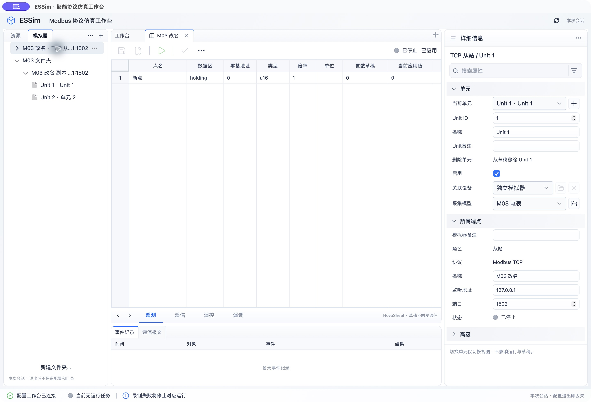

# M03 模拟器配置实施与验证（2026-10-17）

## 范围与基线

本轮按 `implement-modbus-simulator-configuration` 实施会话内配置管理及受控生命周期契约，不接生产协议执行器、SQLite、录制或回放。不提交、不归档。工作区已有配置版本移除、shadcn点表选择器、保存快捷键和点表预览等改动均保留；M02遗留验收不自动关闭。开工基线：前端41项，核心／基础设施42项集成测试及1项文档测试通过。

本轮修改范围为配置领域与应用命令、内存服务、Tauri命令适配、统一客户端、导航、模拟器文档和属性、新增测试及相关文档。没有修改协议库、Turborepo或原型，没有新增依赖。

## 已实施

- `CreateEndpoint` 原子创建一个Unit，独立于仅更新既存对象的 `SaveEndpoint`；类型固定、引用及全局Unit身份检查、备注缺省为空、站号和冲突定位。保存不打开任何资源。
- `CopyEndpoint` 复制权威保存配置及引用，生成全新端点／Unit身份，不复制应用和值；同停止资源参数允许保存。删除先确认释放再清理保存／应用／值／导航成员，模型和设备保留，迟到保存不能复活。
- 核心比较协议字段；查询返回 `applicationMatches`，只读 `inspect_endpoint` 对草稿复用同一比较规则。展示改名不触发应用，协议改变不冒用旧确认值；模型和点展示文字更新复用数据源，保留值草稿。
- 整组应用保留兼容值，禁用不等于删除，移除Unit仅在应用后清理。停止态复位使用选定Unit已应用快照；主站只清缓存并标过期。主站重新应用后保留的缓存也标过期。
- `ReleasePlan` 分段规划／确认／提交。基础设施等待资源时释放目录锁；提交前只核对目标、应用和值及依赖，保留无关对象并发保存。已停止事实不随提交失败回滚。Tauri执行命令放入后台任务，避免未来等待堵塞UI线程。
- `ReleaseDriver`／`ConfirmedBoundary` 区分停止请求与有界释放确认；超时不冒称停止。生产装配仍为无资源的 `StoppedBoundary`，真实启动和读写继续拒绝。
- 独立导航FolderId／父关系／端点成员，禁止循环、孤儿及非空删除。树复用公开菜单，采用“移动到”，禁用目录压缩以保留文件夹入口；重名路径仅显示适配，业务身份不变。
- 新建默认Unit 1、单模型自动选中、多模型显式选择、无模型创建后返回保留参数。枚举复用shadcn，Portal挂到所属原生dialog，避免顶层遮挡；选项不按勾选项重排。
- 端点dirty Tab、整组保存、关闭保存／放弃／取消、Unit删除与启用、复制删除菜单、结构化错误定位和退出目录警告。提交中禁止用Escape关闭确认框，避免把正在提交误认为已取消。

## 复用接口核实

- `@pierre/trees` 1.0.0-beta.6：已安装 `dist/model/publicTypes.d.ts` 提供 `move`、`remove`、`resetPaths` 及 `flattenEmptyDirectories`。业务命令成功后用 `resetPaths` 更新显示；保留稳定ID映射，不用树路径写回协议配置。
- Dockview 8.5.1：自定义Tab关闭调用现有 `closeDocument`；`panel.api.close()` 为确认后的关闭入口，移动事件不能当删除。未引入另一个文档容器。
- NovaSheet core 0.17.3：`GridEngine.commitCellEdit()` 及编辑器 `CellEditorContract.commit` 是现有公开入口。现有统一保存通过聚焦工具栏使活动编辑器提交，再排队保存；系统键组合与编辑中文字的原生复测仍见下方未验事项，不据接口存在宣称通过。

## 证据索引

| 规格／场景 | 自动化证据 | 原生证据／边界 |
| --- | --- | --- |
| 新建单／多／无模型、引用失效、固定类型、站号、迟到保存 | `simulator_configuration.rs` 创建、缺失引用、固定类型、站号耗尽用例 | 无模型阻止创建；进入模型创建后原模拟器名称与端口2502保留；单模型自动选中；两模型时空选择、创建禁用 |
| 多Unit复制、相同参数、无应用和值、失效源引用 | 同文件复制及引用原子失败用例 | 原模拟器复制后模型相同、未运行／未应用；增加Unit 2；复制生成新身份 |
| 元数据直接展示、协议变更待应用、旧空模型预览 | 同文件metadata／inspection；`point_apply.rs`；前端`model.test.ts`、`sheets.test.ts` | 原生改名保存仍已停止／已应用；曾应用／未应用均能展示已保存点表。最后增加的草稿inspection IPC由核心与客户端测试覆盖，未在重启后的独立窗口复测 |
| 完整应用、停机失败／取消、内容变化、提交失败 | `point_apply.rs`、`simulator_configuration.rs`、`simulator_release.rs` | 应用预览显示完整端点、1个Unit、初始化1点；确认后已停止／已应用；未自动启动 |
| 删除超时、依赖保留、Unit删除与空端点 | `simulator_release.rs`、`simulator_configuration.rs` | 同名测试副本删除后树及Tab清除，原模拟器保留；真正运行态仅为受控边界证据 |
| 共用模型独立值、禁用／启用、新增点与不兼容迁移 | `simulator_configuration.rs`、M02`foundation.rs`／`point_codec.rs`／`point_apply.rs` | 禁用保存显示待应用；应用后停止；重新启用迁移预览恢复0点、兼容值保留 |
| 选定Unit复位、旧已应用初值、主站只清缓存、取消 | `simulator_configuration.rs`、`foundation.rs` | 选定Unit确认文案明确已应用快照，确认后配置状态仍已停止／已应用；主站实际远端写入始终未接入 |
| 文件夹稳定身份、移动、重名、循环、非空检查竞态 | 同文件folders；前端navigation用例 | 新建文件夹；带Unit 2草稿移动后选中与备注保留；移回根目录同名同地址消歧；非空删除被核心拒绝且取消后目录保留 |
| dirty、切换、保存等待新编辑、关闭与退出 | 前端`model.test.ts`／`saveShortcut.test.ts`／`window.test.ts` | 属性焦点后原生文件菜单保存；关闭取消保留、保存并关闭、放弃恢复已保存内容；无dirty的已保存会话关闭仍提示配置及文件夹丢失，取消保留 |
| 监听内部／外部占用、TCP主站同远端、RTU独占／共享、部分获取清理 | `resource_contracts.rs`调用现有RunCoordinator；`resource_release.rs`；既有`runtime_contracts.rs` | **仅受控执行器／资源所有者**，没有真实OS监听、串口、EMS或持久化证据 |
| 释放等待不锁住无关保存、失败不回滚停机事实 | `infrastructure/tests/simulator_release.rs`线程与channel协调；失败仓储用例 | 生产执行器未装配；不据线程测试宣称真实网络释放成功 |

以上测试文件位于 `crates/core/tests/`、`crates/infrastructure/tests/` 和 `workbench/src/features/workspace/`。规格中未装配执行器场景由生产能力门禁及上述用例覆盖；空态、禁用运行按钮不产生模拟通信结果。

## 构建结果及未验事项

- 前端44项测试、生产构建和TypeScript检查通过；保留既有大chunk提示。
- 核心／基础设施62项集成测试及1项文档测试通过；桌面开发构建及 `cargo doc --no-deps` 通过。
- `cargo test --workspace --offline`未通过：未改动的libmodbus-sys构建缺少autoconf。未安装额外构建工具或修改协议库规避检查。
- 原生环境为macOS系统WKWebView，使用独立的 `ESSim M03 Check.app` 测试窗口和测试数据，没有退出用户原有窗口。开发过程中前端热刷新会重建Tab；最后补充的只读草稿比较IPC已构建并自动化测试，独立窗口未重启验证。
- **仍待完整原生复测**：系统⌘S及正在编辑表格文字时保存；保存等待时继续编辑；最后一轮inspection IPC的元数据草稿确认列。CUA键组合模拟此前不能可靠产生真实⌘S，因此文件菜单证据不能替代该项。Windows／Linux均未验证。任务6.5、8.4保持未完成，M03大类验收不打勾。
- 未宣称实际协议通信、暂停、录制／回放、SQLite、跨会话恢复或规模性能；M02原生遗留验收独立保留。

## M04／M05必须增加的独立资源验收

实施前先明确M06并发、资源所有权及状态同步约束。以独立工具占用／释放TCP监听端口，验证内部占用者、外部未知占用者、通配地址与具体地址重叠；两个主站同远端连接不视为监听冲突。真实串口验证别名、设备移除、独占、同通道多目标串行访问和释放后重开。部分获取失败、停止超时、反复启动／停止、不同端点故障隔离均须在目标OS记录实际句柄与操作结果；本轮受控适配器不能替代这些证据。
