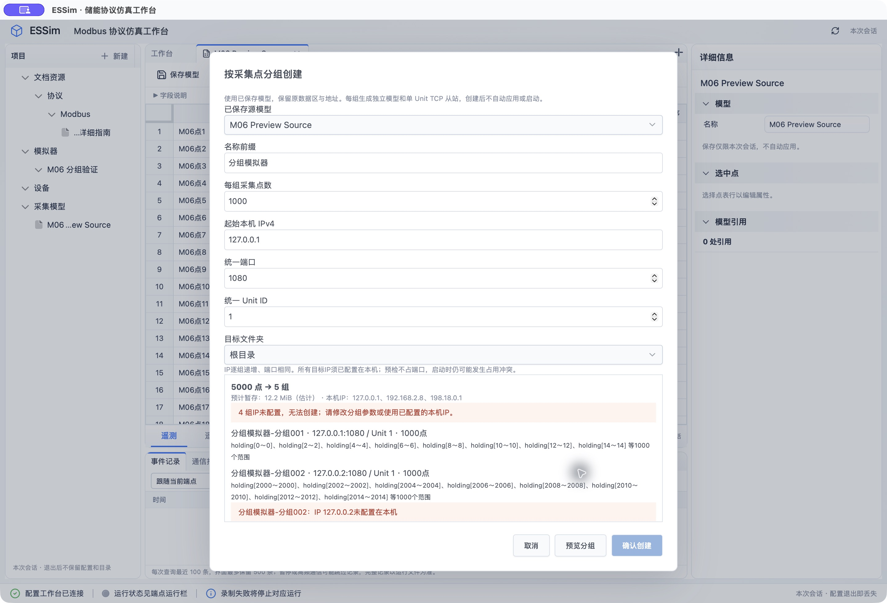
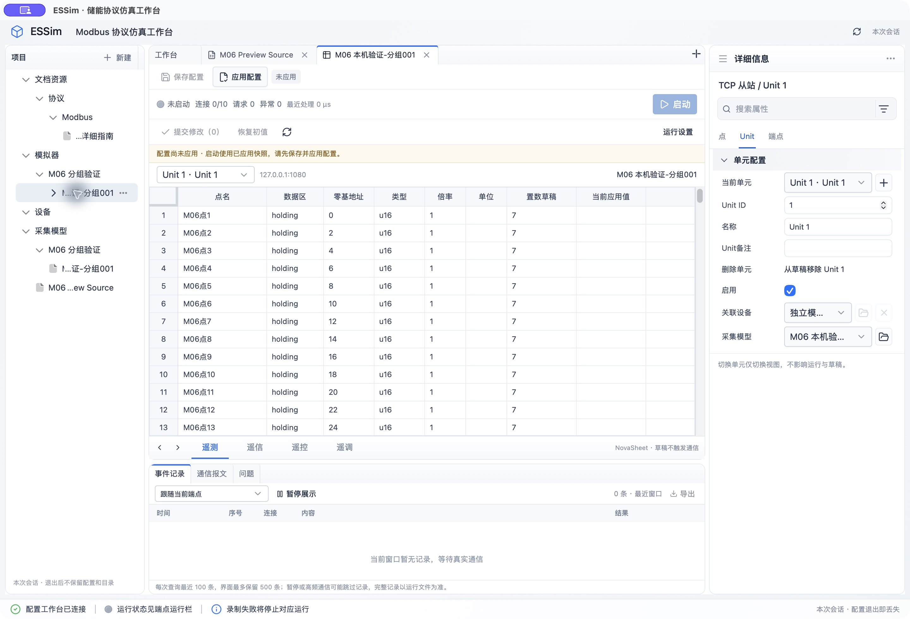
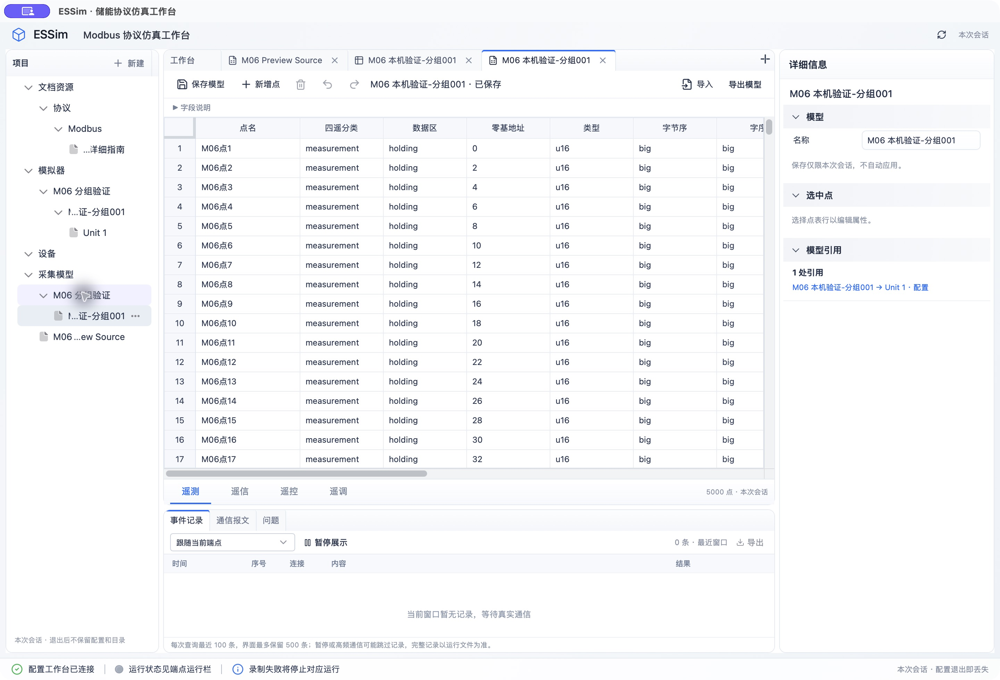
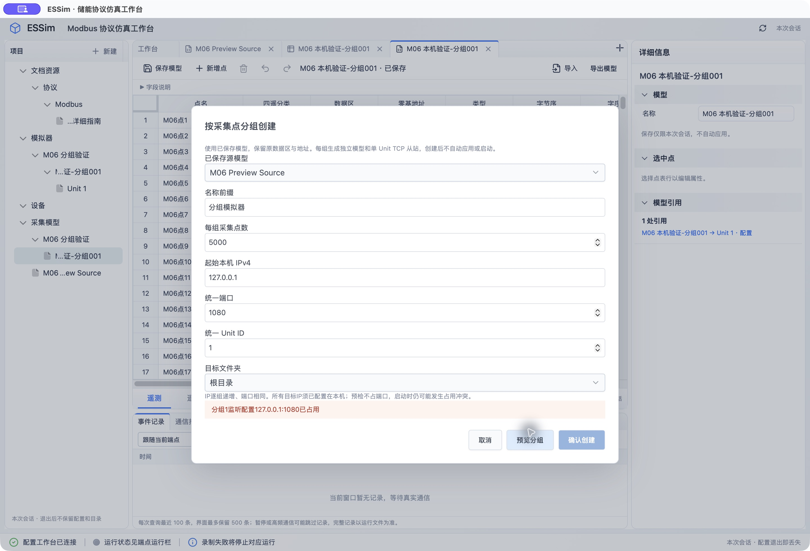

# M06 首阶段：基线、分组创建与任务状态

日期：2026-10-19。关联[实施任务](../../openspec/changes/implement-modbus-multi-instance-orchestration/tasks.md)。本记录不是M06整体验收，也不是千端点典型亿点组合验收。

## 环境及方法

macOS 26.5.2（25F84）、arm64、Apple M3 Pro、12逻辑核、18GiB内存；Rust 1.99.1、Node 24.12.0、pnpm 11.1.2。使用debug构建。参数原文见[环境](assets/m06/environment.json)。改动前完整Rust回归144项通过；TCP／RTU保留逐事件sync_data，不关闭录制。

使用现有`scripts/measure_tcp_slave_runtime.py`运行10端点×10Unit×1000点、每端点1连接。该脚本依次完成客户端全表扫描，不能当作持续并发EMS负载。`ps`在启动后、扫描后采RSS和线程；CPU只是一次快照，RSS不是持续采样峰值。独立PyModbus驱动器、Tauri桌面与核心进程的合计内存未测。

- 启动3.398秒；一轮扫描6.991秒，800请求，114.43请求／秒。
- 单请求P50 8.426ms、P95 11.990ms；未测P99。
- 启动后RSS 69,584KiB，扫描后39,248KiB；5线程，CPU快照15.5%。
- 原始结果：[运行基线](assets/m06/baseline-runtime.json)。该轮没有覆盖30分钟、慢连接或10／5／1秒节奏压力。

新增`crates/infrastructure/examples/m06_baseline.rs`，对同一快照分开测量目录克隆、序列化、模型／Unit暂存、布局编译、C映射分配和同步落盘。以下为单次运行的均值／耗时，不是分位数或内存峰值：

| 操作 | 结果 | 方法与边界 |
| --- | --- | --- |
| 完整目录克隆 | 32.882ms／次 | 10次；包含当前重复的已应用UnitValues |
| 完整目录序列化 | 1312.508ms、32,743,085字节 | 1次JSON；不能用于高频摘要查询 |
| 单模型克隆 | 0.190ms／次 | 100次，1000点 |
| 单Unit原始值克隆 | 0.137ms／次 | 100次，不含模型定义 |
| 单UnitValues克隆 | 0.328ms／次 | 100次，包含内嵌模型 |
| 单模型布局编译 | 15.044ms | 1次，包含必要克隆及索引 |
| 单C映射分配及释放 | 0.000285ms／次 | 100次，按四区地址跨度分配；不含初值写入 |
| 写1024字节并sync_data | 3.437ms／次 | 100次，同一临时文件；不是端点录制吞吐 |

原始结果：[独立成本](assets/m06/baseline-costs.json)。模型和原始值分开测量，映射分配与布局编译分开；不把分配时间或JSON长度当作实际RSS。测试文件随后删除。

复现隔离成本测试：先按已有测试工具生成10端点、每端点10Unit、1000点的教学快照（下列端口只写入测量输入，不监听），再执行。Python需安装example/requirements.txt中的PyModbus：

```sh
PYTHONPATH=scripts python3 - <<'PY'
import json
from pathlib import Path
from verify_tcp_slave_runtime import snapshot
Path("/tmp/m06-baseline-snapshots.json").write_text(json.dumps([snapshot(f"e{i}",20000+i,10,1000) for i in range(10)]))
PY
cargo run -p essim-infrastructure --example m06_baseline --features tcp-runtime,vendored --offline -- /tmp/m06-baseline-snapshots.json /tmp/m06-sync-probe
```

## 首批预算的适用范围

参数见[工程限制](assets/m06/resource-policy.json)和`infrastructure/src/resources.rs`：估计内存2GiB、运行端点1000、连接10000、队列64MiB；任务清单1024、预览8MiB、每端点录制1MiB、录制批次64KiB／最多等待5ms。

2GiB约为本机18GiB的11%，暂存按源模型序列化长度×8预留，用于容纳字符串／树节点及构造、仓储、事件和投影副本；这只估计本次源／生成对象的暂存，未计入无关目录深复制，尚无RSS峰值校准；完整事务峰值准入仍归任务4.2／4.5。一次目录JSON已约32.7MB，因此预览限制为8MiB并排除完整点表。现有每次同步约3.4ms，5ms合批窗口作为后续实验起点，未证明吞吐改善；64KiB批次、1MiB单端点／64MiB总队列和1024目标是限制实验影响的起始值，尚需持续负载测量后校准。端点／连接上限沿用既定目标与现有限制，不表示已承载。

**当前仅分组预览／创建暂存接入资源账本**。失败或取消、被新预览替换、提交结束均释放唯一RAII令牌；旧弹窗的取消不能释放新预览。运行映射、连接、手动／批量生命周期和录制队列尚未统一接入，不能将该账本称为全进程内存监控。预览5分钟后禁止提交；缓存也可由关闭或下一次预览释放，不宣称有定时后台清扫器。

## 已实现及验证

- 按完整业务点分组，默认1000点；coil／discrete／holding／input、地址及稳定ID排序。5000点得到5组；空洞不计点，跨寄存器点完整保留，余组不丢。
- 各组保留地址、初值和其他点定义，模型／点／端点／Unit使用新身份；源模型、其他副本及实时值互不借用。全部新配置保持未应用、未启动。
- 预览不改目录；提交前重查源内容、文件夹和冲突，一次仓储提交与PartitionCreated事实。测试覆盖中间组身份冲突、文件夹删除、源模型变更、仓储失败、资源额度耗尽和无残留。
- Unix接口枚举只读真实本机IPv4；127.0.0.1可预览；2026-10-20修复后未配置IP保留分组摘要并逐项提示，禁止创建且不缓存提交计划，不配置系统IP。仅软件逻辑验证五IP递增，没有修改网络来运行五IP实例。
- 前端增加分组对话框和统一IPC；采集模型可与生成端点放在指定文件夹。预览最多显示100组及每组前8个地址段，完整摘要还受8MiB限制；尚未实现分页。
- 批量任务聚合及服务／命令／事件／监听／查询按目录拆分。测试覆盖状态数量守恒、取消、重复／非法转换、未确认占槽、真实结束才结算、旧通知不得倒退投影。尚未接到真实生命周期执行器。

本轮完整Rust工作区回归[165项（含文档测试）](assets/m06/workspace-tests.log)通过，前端[94项](assets/m06/frontend-tests.log)通过；TypeScript／Vite构建和Tauri cargo check通过。后续准入估算改为流式计数、在复制源内容前预留，另补运行对应[分组准入回归](assets/m06/partition-admission-tests.log)及[批量状态／事件回归](assets/m06/batch-tests.log)，均通过。前端构建保留既有大chunk提示；未为此改变打包策略。

## 尚未验收

静态开发测试包已生成于`target/artifacts/static/ESSim.app`（[构建记录](assets/m06/macos-bundle.log)，仅本机ad-hoc签名，不含公开分发／公证验收）。2026-10-19原生验证曾被Mac锁屏阻挡；2026-10-20解锁后已完成下述首轮原生验证。绑定预检不占端口，启动时的外部竞争仍按既有从站失败路径处理，新分组流程的独立互操作待补。

批量固定执行器、真实批量应用／启停／取消／安全重试、统一资源准入及面板、目录按需查询、异步可靠录制、阶梯短探测和30分钟持续规模验证均未交付。真实RS485继续按用户要求暂跳过。M06总览保持未勾选。


## 2026-10-20 原生复查与冲突预览修复

本轮使用重建的静态开发包，独立副本`ESSim M06 Preview Check.app`，标识`dev.essim.m06previewcheck`，不连接旧RTU测试会话。原ESSim退出操作被自动审批拒绝，随后取消退出并保留该会话；没有清空已有测试数据。以下操作全部在独立副本进行。

1. UI新建源模型，导入5000行CSV并显式保存。测试约定为holding地址0、2、…、9998，u16，初值7，特意保留空洞。
2. 默认1000点／组、127.0.0.1起始、1080端口、Unit 1，显示`5000点→5组`。后四个递增IP不在当前系统接口中，逐项显示原因，确认创建按钮禁用。没有添加系统IP或宣称五IP监听成功。
3. 此处发现旧实现只报首个IP错误、隐藏整张分配清单，已先加失败用例再修复。后端现在返回`canCreate`及逐IP问题；未通过的预览不缓存可提交计划，也不占用保留额度。服务端仍拒绝对其token提交，界面按钮不是唯一保护。整个预览响应使用流式计数，受8MiB限制。
4. 改为5000点／组，选择`M06 分组验证`，前缀`M06 本机验证`，预览一组有效127.0.0.1。确认后独立模型及TCP端点一起出现在各自树的同名文件夹；新模型5000点、1处引用，源模型仍保留。端点显示Unit 1、未应用、未启动、0连接；未自动应用或通信。
5. 再预览同一IP／端口的新命名分组，明确提示`分组1监听配置127.0.0.1:1080已占用`，确认创建禁用。取消后仍仅源模型、已生成模型及一个端点，没有新残留。这是已保存配置冲突，不是外部进程占端口测试。

证据：[会话参数](assets/m06/native-validation.json)、[五组预览AX](assets/m06/native-five-groups.ax.txt)、[生成端点AX](assets/m06/native-created-endpoint.ax.txt)、[生成模型AX](assets/m06/native-created-model.ax.txt)、[冲突后目录AX](assets/m06/native-after-conflict.ax.txt)。









修复后的前端94项测试、TypeScript／Vite构建、静态原生打包和OpenSpec严格校验均通过，相关日志位于本目录assets/m06下。后端[资源及预览令牌2项](assets/m06/native-fix-resource-unit-tests.log)、[分组集成4项](assets/m06/native-fix-partition-integration-tests.log)通过（包括5000点／五组／无效IP不可提交）。本轮未运行真实五IP端点互操作、批量生命周期或持续规模；任务7.4整体继续未勾选。任务6.2已按本次界面范围勾选，M06共10／46项完成。
