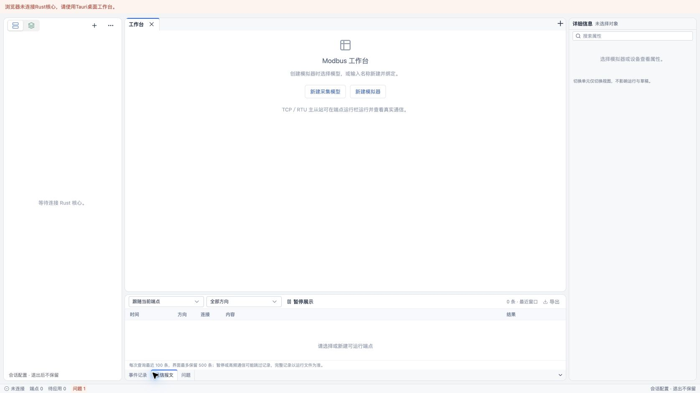
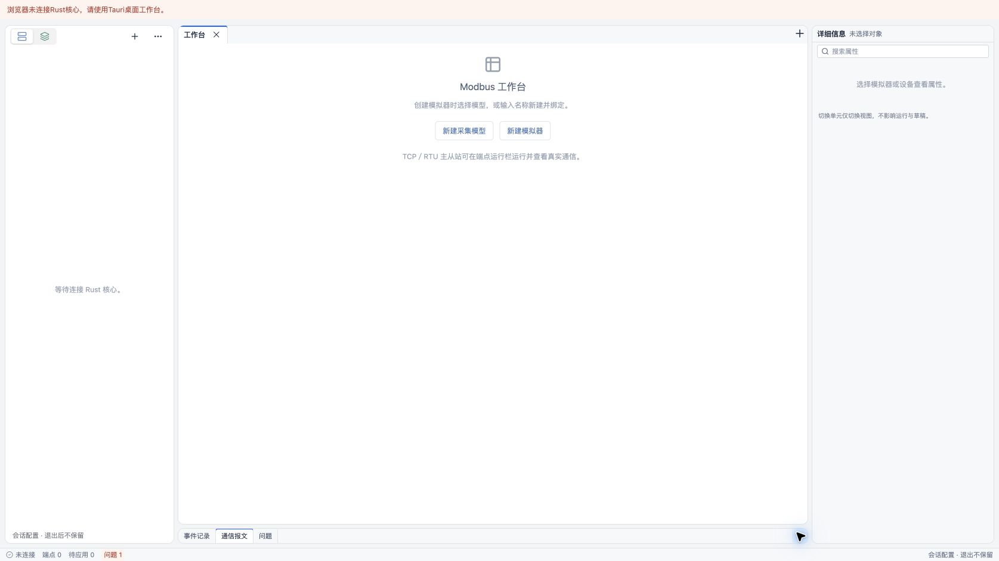

# 工作台底边观测面板与紧凑状态栏

2026-10-22 用户要求将事件记录／通信报文／问题移到 Dockview edge，默认收起，压缩状态栏并保留关键状态。

最初使用仓库实际安装 Dockview 8.5.1 的 `addEdgeGroup("bottom")`，三个工具放入同一个底边组，标题栏位于底部。初始收起，点击标签展开（最初横跨整个工作台，现已调整为中央列，见下文），右侧按钮收起并归还编辑空间；保留拖动调整展开高度。默认展开高度210px、底边标签26px。收起状态下观测组件沿用可见性订阅，避免继续查询不可见面板。

底部状态栏固定22px，展示配置服务连接、端点数、待应用数、实际模型校验问题／全局错误数，以及会话保存提示。“问题”计数可打开对应底边面板。运行状态仍由已有端点运行栏显示，不增加状态栏轮询或虚构运行信息。

验证：`pnpm --filter @essim/workbench build` 通过（保留既有大chunk提示）；`pnpm --filter @essim/workbench test` 21文件112项通过。独立浏览器预览实际验证默认收起、点击事件记录展开、切换通信报文、按钮收起、状态栏问题入口展开；截图见[默认收起](assets/bottom-edge/collapsed.png)和[展开](assets/bottom-edge/expanded.png)。浏览器未连接Rust核心的提示为实际状态，本轮未新增协议行为或宣称完成原生全平台验证。

## 背景与顶部衔接复查

同日根据用户反馈，将标题栏下方留白由3px增加到10px，并检查整个窗口背景层次。原工作台外层使用蓝灰渐变，Dockview标签栏叠加另一渐变，属性栏又采用中性灰，导致边缘色调不统一。

现使用统一实色：外框 `#f3f4f6`、内容 `#ffffff`、标签／工具栏及状态栏 `#f7f8fa`、外框边线 `#dfe3e8`。去除外层与Dockview标签栏渐变及外框阴影，属性栏顶栏与宿主工具栏对齐。保留蓝色激活标记与业务状态色。页面加载背景明确为亮色；系统原生标题栏仍由macOS绘制。

`pnpm --filter @essim/workbench tauri build --debug --bundles app`（独立验证标识 `dev.essim.backgroundcheck`）构建通过；在系统WebView实际复查空工作台、顶部留白、底边面板展开／收起及状态栏背景。[原生截图](assets/background/native.png)。纯样式调整未新增测试，不重复声明前次112项测试为本次执行。

### 红框位置的根容器露白修正

用户进一步明确：问题是文档区与属性栏之间的竖缝，以及左下圆角外的白色区域。检查Dockview安装包样式确认 `.dv-dockview` 默认使用 `--dv-group-view-background-color`，与白色面板共用背景；此前仅修改外框灰阶未处理此根因。现仅为 `.workbench .dv-dockview` 指定工作台底色，保留组面板自身白底。独立 `ESSim Gap Check.app` 构建通过，并在原生WebView确认竖缝、圆角外侧已与工作台外框同色。[修正截图](assets/background/gap-fixed.png)。

## 中央圆角输出面板

同日根据用户最新反馈，事件记录／通信报文／问题改为中央工作区下方的独立圆角面板，不再延伸到左右边栏下方。导航与属性使用Dockview原生left／right edge，输出区继续使用bottom edge；库内shell的左右栏包围中央列，因此宽度和分隔线由实际布局计算，无需固定偏移或覆盖定位。

输出面板继承工作台统一10px圆角、边框和背景，与文档区间距6px。按用户最终要求默认展开并选中“通信报文”；保留收起后的26px底部标签、点击标签展开、右侧收起按钮、状态栏问题入口和拖动调整高度；左右边栏继续可调宽度。数据查询与错误展示不变。

本次`pnpm --filter @essim/workbench build`通过（既有大chunk提示保留），`git diff --check`通过。macOS Chrome真实工作台验证：输出面板和中央文档区初始均为x=298、宽1057px，圆角10px，间距6px；收起后输出区26px。左栏拖宽40px后，上下两块均移动到x=338、宽1017px；再将上下分隔线拖高40px，输出区从207px增至247px，左右边栏保持全高。事件记录／通信报文／问题切换、收起及状态栏问题入口展开均验证通过。再次构建并重新加载页面，确认无需点击即选中“通信报文”、面板展开且高207px。布局／样式调整未新增镜像测试，也未重跑协议测试。

本次浏览器无Rust核心，断连提示与空通信记录为实际状态；未新增样例记录，未将浏览器验证当作Tauri原生通信验收。前文原生截图属于上一次背景调整，不代表本次布局已在原生窗口复验。
