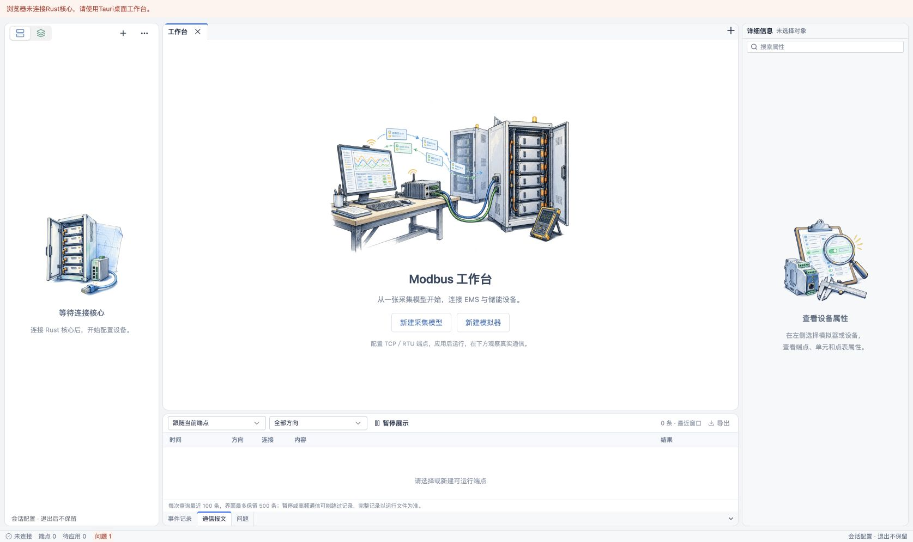
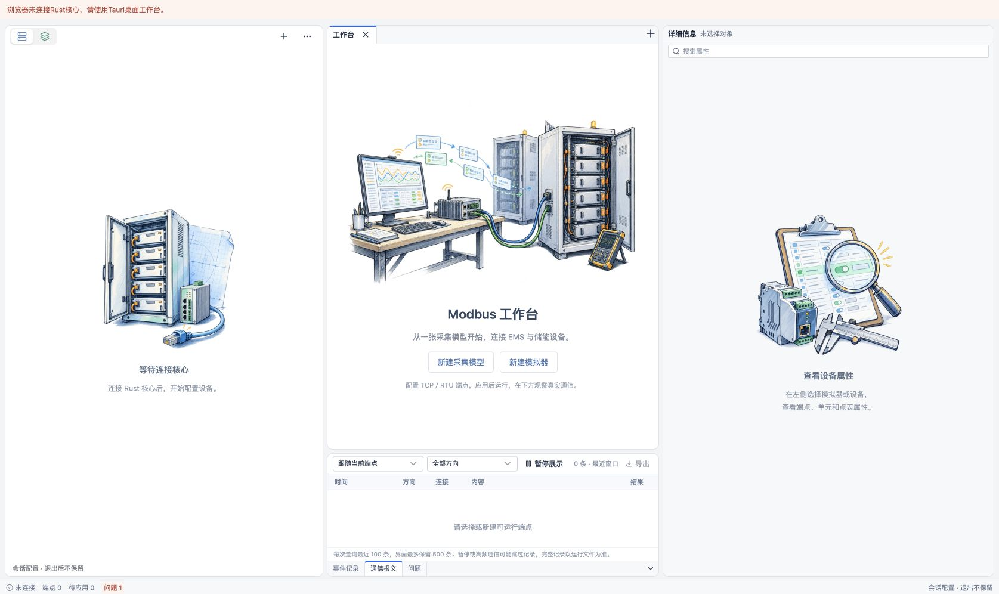
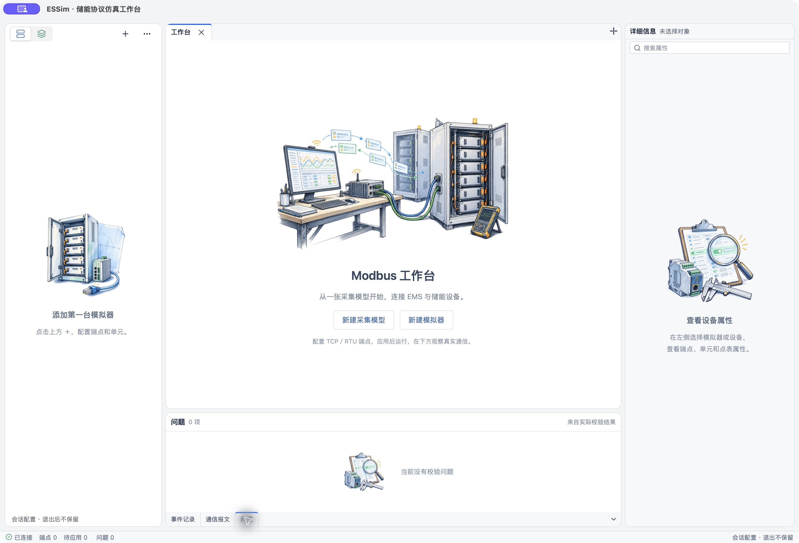

# 工作台业务空态插画（2026-10-22）

当前已按用户后续确认改为轻量工程线稿，尺寸沿用本记录的小幅方案；最新素材与原生验证见[轻量线稿记录](2026-10-23-light-illustrations.md)。以下保留此前写实、黑白与缩小迭代的历史证据。

按用户标出的中央欢迎区、左侧模拟器空态与右侧未选对象空态，重新设计为大幅、统一风格的储能业务草图。使用内置imagegen生成透明PNG，不采用普通小图标放大。

中央是EMS工作站、网关接线、电池机柜与双向报文的联调场景；左侧是开门电池机柜、工业网关和待连接网线；右侧是点表、放大镜、通信模块和检查工具。初版采用蓝灰手绘轮廓与蓝绿浅色；用户反馈与灰白系统不协调后，已改为黑白工程线稿，保留业务构图和透明背景。三张均不绘制界面文字。

三张原始素材已复制到正式工程，由Vite打包为本地资源。尺寸、用途和完整生成提示词见[素材说明](../../workbench/src/features/workspace/illustrations/README.md)。`WorkspaceIllustration`统一输出装饰图，空`alt`与`aria-hidden`避免屏幕阅读器重复朗读；业务标题、说明与真实操作保持原生文本和按钮。

初版欢迎页插画展示区域宽度最多760px，高度随窗口与比例约束，两侧插画各250px并受可用栏宽限制。中央整体垂直居中；可用空间缩小时允许滚动，不以插画覆盖按钮。右侧未选对象时，原先孤立的单元说明只在已选端点时显示；实际属性字段与搜索行为不改变。

## 验证

- `pnpm --filter @essim/workbench build`通过，包含三张带hash的本地图片资源，保留既有大chunk提示。
- macOS Chrome实际工作台验证三张图片均完成加载，透明底与白色／浅灰面板衔接。中央展示区域760×约418px，两侧各250×250px。
- 调整左右栏使中央内容区缩至555px时，插画缩至491×约327px，无横向溢出，文字和操作仍可见；验证后恢复原有常用栏宽。
- 资源标签切换后仍显示原资源树，设备草图不会遮挡资源列表；返回模拟器标签恢复空态。默认展开的通信报文区保持原样。
- 浏览器无Rust核心时，保留断连横幅、等待连接文案与禁用的新建按钮；未伪造设备或运行记录。

本轮仅调整插画、空态文案及布局，未改协议逻辑，不新增镜像样式测试。未在Tauri原生窗口复验，也未重验真实通信和性能。画中的波形、表格和连线仅作业务插画，不是运行数据或现场接线图。

## 黑白风格修订

根据用户最新反馈，使用内置imagegen逐张编辑原素材，改为黑白轮廓与灰度排线，去除彩色填充。三个新文件以`-mono.png`保存并更新正式组件引用，原始彩色图仅作生成参考保留。没有通过CSS滤镜或运行时Canvas处理图片。

`pnpm --filter @essim/workbench build`再次通过，输出三张带hash的`-mono`本地资源。macOS Chrome真实工作台复查三张资源加载完成，黑白线稿与白色／浅灰面板协调；中央展示区域仍为760×约418px，两侧各250×250px。布局和业务逻辑未修改，不重复运行协议测试；本次仍未进行Tauri原生窗口复验。

## 恢复彩色并缩小展示

用户最终选择上一版彩色素材，认为插画过大。本次恢复三个原始彩色PNG的引用，将中央宽度由760px降至500px、高度上限由470px降至320px，两侧由250px降至160px。仅调整资源引用与展示CSS，不重新生成或改写图片，保留比例、透明背景与原有操作。

`pnpm --filter @essim/workbench build`通过。macOS Chrome复查三张均加载原彩色资源，中央展示区域为500×约299px，两侧各160×160px，空态文案和按钮清晰可见。未重验Tauri原生窗口和协议通信。

## 底部事件／通信空态补图

补充`communication-log.png`，由内置imagegen生成同风格的透明彩色网关、网线与记录纸草图，原图及完整提示词保存在上方素材目录。`ObservationPanel`在无可见记录时通过共享`WorkspaceIllustration`显示110×74px插画，文字位于其右侧，保留原来的端点未选择、展示暂停及等待真实通信判断。存在记录时仍显示原记录行；实际错误继续独立展示。

空态表格改为纵向flex分配表头之外的空间，避免原先`height:100%`再加表头引入多余滚动。正常记录列表不改变布局、查询、筛选、暂停或导出行为。

`pnpm --filter @essim/workbench build`通过（既有大chunk提示保留）。macOS Chrome验证事件记录和通信报文两个标签均显示插画，图片加载完成且展示尺寸110×74px；默认高度下表格`clientHeight`与`scrollHeight`均为123px，没有新增竖向滚动。当前浏览器无Rust核心，保留真实端点选择提示；未重验原生通信或录制。

## 问题面板空态补图

“当前没有校验问题”空态复用已有点表检查插画，使用与事件／通信空态一致的110×74px展示区域与横向居中布局，不新增图片。插画仍仅在校验问题数为零且没有全局错误时显示，实际错误和问题定位入口保持原样。

前端构建通过。另以独立标识`dev.essim.illustrationcheck`构建`ESSim Illustration Check.app`，命令为`pnpm --filter @essim/workbench tauri build --debug --bundles app --config '{"identifier":"dev.essim.illustrationcheck","productName":"ESSim Illustration Check"}'`；构建通过，既有大chunk提示保留。macOS原生系统WebView连接真实配置核心，空目录下切换“问题”标签，确认“0项”“当前没有校验问题”和插画同时显示，工具栏及底部标签保持可见。截图后关闭独立验证窗口，没有创建测试设备或运行协议。

