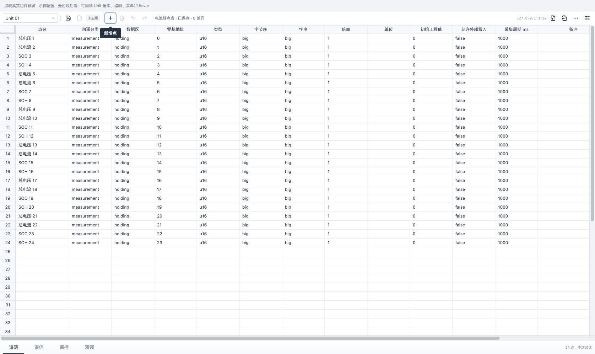
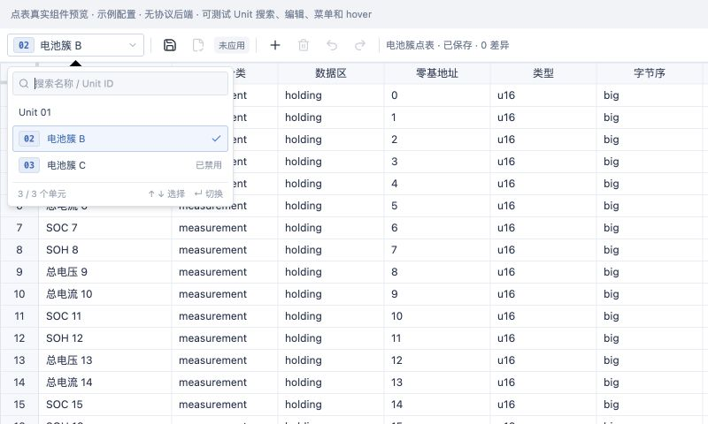

# 点表工具栏与单元切换（2026-10-22）

## 变更

按用户确认的图标设计实施正式工作台：配置页的端点操作、单元上下文和点表操作合并为38px单行；保存实例、应用、新增／删除、撤销／重做、导入／导出与配置／运行使用图标和可访问名称，提供hover／焦点提示。Unit、模型名、状态和地址继续显示文字。

端点保存、保存并预览回写、恢复全部模型配置、另存为新模型并绑定及继承／覆盖／隐藏点入口收进“更多”。继承与隐藏点恢复仍可按需展开，真实错误／模型变化横幅继续显示。移除顶部字段说明及重复说明行；模型独立编辑页同步图标化。操作回调、整端点保存和显式应用语义保持不变。

新Unit选择器在工具栏和属性栏共用：默认名合并为`Unit 01`，自定义名以ID徽标加名称显示；搜索名称／线上站号，使用稳定ID切换，当前项勾选，禁用单元仍可查看。切换前刷新编辑器缓冲到草稿，不自动保存和应用。

`sheetTheme`去掉28px行高和31px表头覆盖，使用当前NovaSheet core 0.17.3的`denseGridTheme`默认25px／25px；编辑、实例配置和运行表共用。未修改第三方代码或以CSS缩放Canvas。

规范见[点表工具栏与单元切换](../design/point-toolbar.md)。

## 验证

- 新增默认名去重／保留自定义名、名称／站号搜索、稳定身份与禁用状态保留的用例；首次运行因实现尚不存在失败，实施后通过。
- `pnpm --filter @essim/workbench test`：21个文件112项通过。
- `pnpm --filter @essim/workbench build`：TypeScript与Vite生产构建通过，保留既有大于500kB包体提示。
- `git diff --check`通过。
- 当时在macOS Chrome独立预览夹具中挂载真实`UnitPointEditor`、`UnitSelector`与NovaSheet，仅使用明确配置样例，不提供协议运行或伪造保存成功。该预览 HTML 入口现已移除，此项保留为历史验证证据。
- 实测工具栏38px，无字段说明条。确认默认`Unit 01`去重，搜索`02`并Enter切至自定义名称，列表保留当前勾选与已禁用标记；不存在搜索显示空态。
- 新增点使24点变25点、显示未保存并启用撤销／删除。更多菜单保留全部操作，导出菜单含JSON／CSV／XLSX；导入按钮打开原有追加预览对话框。键盘聚焦“新增点”显示提示。

## 边界

本轮未执行Tauri原生窗口中的保存／应用和文件导入导出操作，也未重验真实通信、串口硬件、规模、表格填充／粘贴与中文输入。保存／回写等业务行为继续由既有测试支撑；浏览器验证只证明界面入口与交互，本轮不替代先前仍待完成的原生验收。运行协议专属控制区未纳入本次配置页单行工具栏设计。
