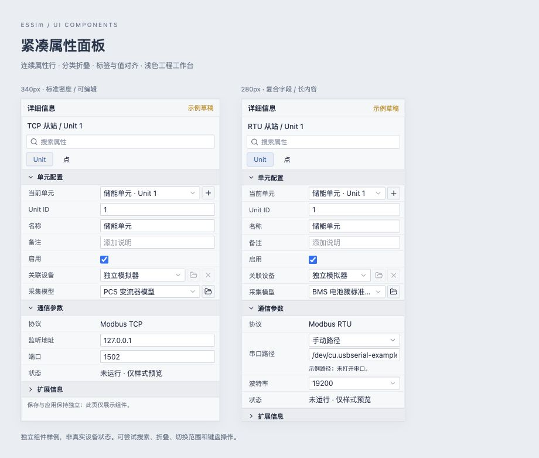
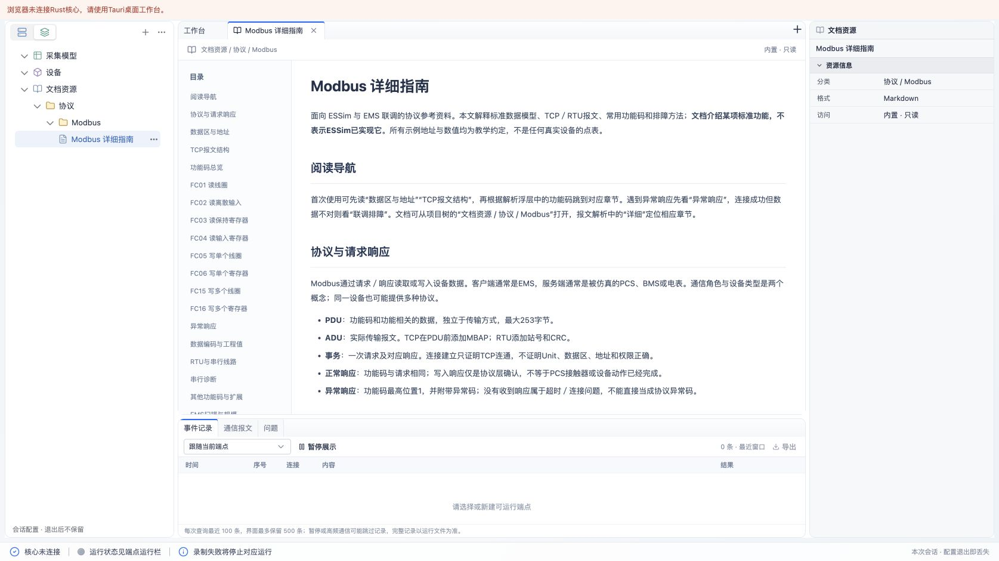
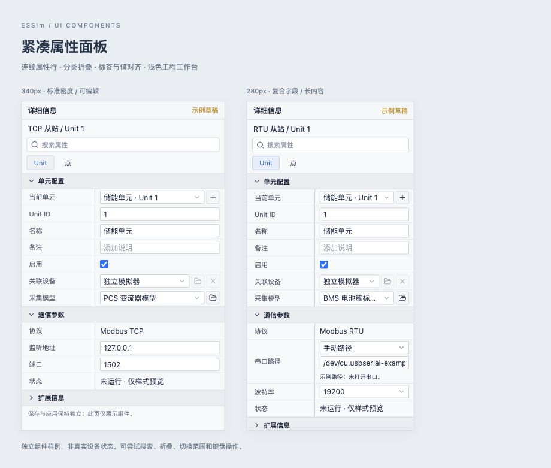
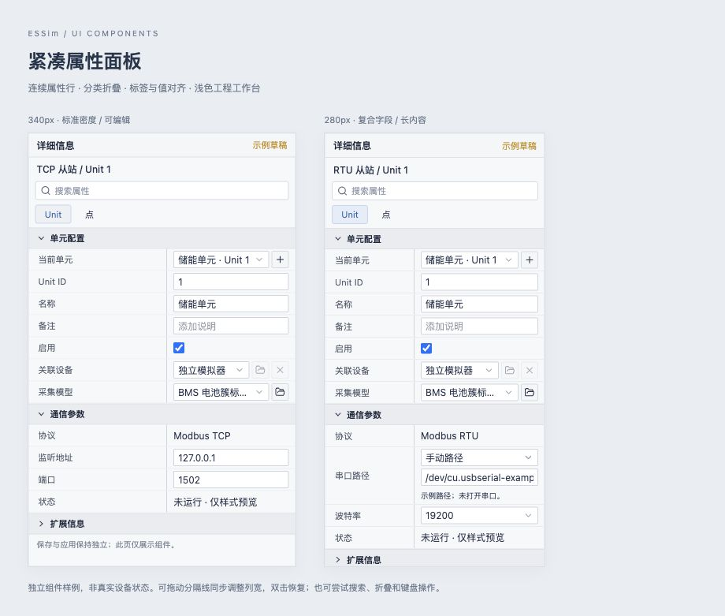
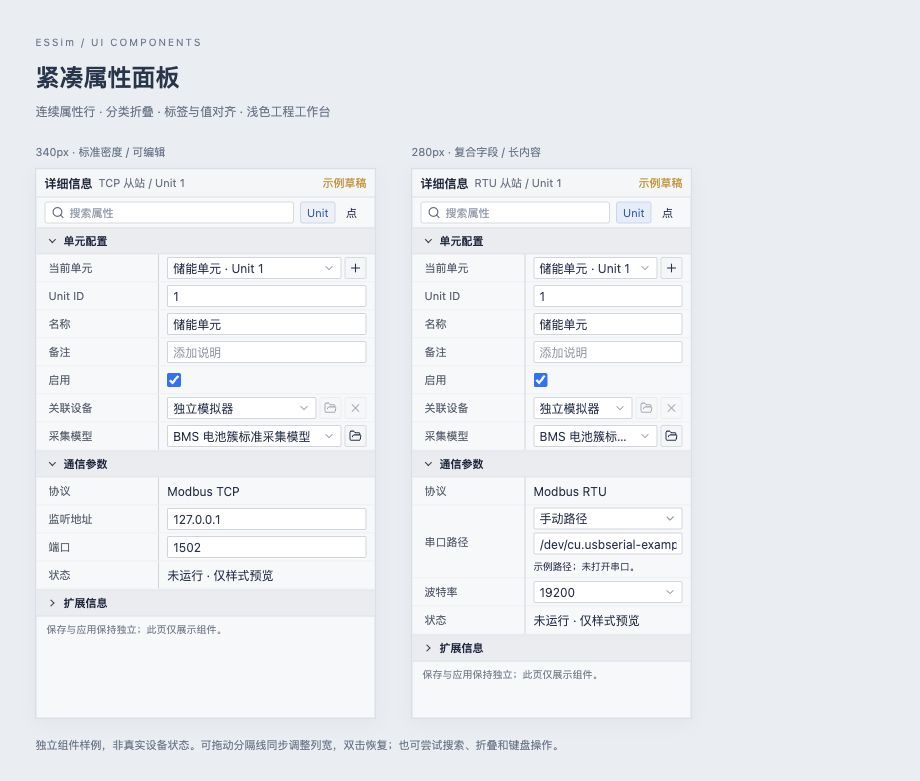

# 紧凑属性面板组件（2026-10-22）

## 实施范围

按用户要求参考 UE 属性面板重新设计密度，并抽离共享组件。新增 `PropertyPanel`、`PropertyGroup`、`PropertyRow`、`PropertyActions`、`PropertyIconButton`、`PropertyScope`、`PropertyHint`；样式在 `@essim/ui` 内维护，业务专属串口、字段帮助和引用列表修饰留在工作台。

正式工作台的端点、Unit、运行点、设备、文档资源和模型点编辑已改用共享组件。移除原属性面板重复结构及旧全局样式；下拉与输入统一22px，标准属性行28px，分类标题27px。搜索支持字段名与显式关键词，自动展开匹配分组，清空恢复折叠状态，并显示无结果提示。

保存／应用、协议处理与运行值边界未修改。README提供入口，AGENTS.md要求按[接入规范](../design/property-panel.md)扩展；独立预览页只展示示例值，不向正式应用注入配置或运行状态。

## 验证

- 重构前既有前端测试：18个文件、98项通过。
- `pnpm --filter @essim/ui typecheck`：通过。
- `pnpm --filter @essim/workbench test`：19个文件、100项通过。新增用例覆盖搜索名称／关键词、面板隔离、复合字段可访问名称、稳定校验定位标记及按钮不提交表单。
- `pnpm --filter @essim/workbench build`：TypeScript检查和Vite生产构建通过；仍有大于500kB的既有打包体积提示。
- macOS Chrome组件预览：340px和280px外框的面板内容宽度分别338px、278px，`scrollWidth`与`clientWidth`相等；标准行实际28px，下拉实际22px。长模型名称单行截断，多行串口示例自动增高。
- 交互：折叠单元分组后搜索 ` unit ` 能找到Unit字段并展开；清空恢复折叠。搜索不存在字段显示无结果，另一个面板不受影响。切换点／Unit范围保留状态；模型下拉可选择PCS，禁用字段保持禁用。
- 正式工作台浏览器入口：真实内置Modbus指南可打开，右侧文档属性使用共享分组，三行实际高度均为28px；面板308px宽，无横向溢出。无Rust核心时仍显示未连接状态。
- `git diff --check`：通过。

## 验证边界

本轮没有进行Tauri系统WebView复测，没有重新验证真实端点编辑／保存／应用、串口发现、协议互操作、规模或NovaSheet交互。浏览器示例中的串口路径与设备字段仅用于检查布局，不是协议或硬件证据。

## 名称／值列分隔修正

用户指出遗漏纵向分隔线。核对 Epic 官方属性行、列宽 API 和 UE5 教程截图后，将行内 gap 改为独立单元格内边距；在值单元格左侧绘制1px边界。分隔线撑满整行，分类标题和提示通栏，不穿过标题。标签列最小宽度112px包含文字内边距；默认比例与分隔线颜色在面板根级统一控制。

- Chrome预览：340px外框内，各行分隔线距离内容左边缘121.68px；280px外框内均为112px。两面板仍无横向溢出。
- 单行总高28px，值单元格和纵线高27px，剩余1px为行底边界；串口示例总高73px，纵线高72px。输入、下拉、复选框、只读值与复合字段边界一致。
- `pnpm --filter @essim/workbench build` 通过，仍有既有打包体积提示；纯布局修改不重复新增逻辑测试。
- 当前分隔线不可拖动，未使用调宽光标；UE的可调列宽与右侧独立扩展列仅记录为参考，不声称已交付。

## 面板级同步列宽

后续按用户要求在共享组件内增加拖动。每行只提供分隔线命中区，列宽由最近的`PropertyPanel`统一持有，以比例更新根CSS变量；不同分组、只读值和多行字段同步，不需要应用编写逐行同步逻辑。状态属于当前已挂载面板，不写业务配置。上述静态分隔线限制由本节取代。

- 指针捕获使拖动可跨出原行；释放、取消、丢失捕获及分隔行卸载时清理拖动状态。
- 支持左右方向键8px、Shift加速24px、双击／Home恢复默认。常规名称列最小112px、值列最小120px；极窄时按45%／55%退让。
- 新增列宽范围用例，覆盖常规左右边界、正常输入、极窄面板及零宽测量。完整前端测试20个文件110项通过（含当前工作区已有其他测试）；最终定向组件3项测试、UI类型检查及前端生产构建通过。仍有既有打包体积提示。
- Chrome实际拖动：340px外框面板内拖动60px后11行边界均约182px；另一280px面板仍为112px，均无横向溢出，释放后拖动态关闭。
- 向右大幅拖动限制在218px（338px内容宽度减120px）；向左拖动窄面板保持112px。双击恢复默认。键盘向右从121.68px变为129.68px，实际增加8px。
- 搜索、清空、切到点范围后再切回Unit，列宽继续保持174.68px；其他面板保持独立。分隔器可访问数值反映当前有效列宽，包括CSS最小值钳制。
- 本轮未在Tauri原生窗口复测触摸／指针捕获与Dockview窗口缩放，也未重验协议通信。

## 头部压缩为两行

按用户反馈，将原先标题、对象、搜索、范围四层结构合并为两行。标题与对象、状态同处28px标题行；搜索与范围按钮同处30px工具行。`PropertyPanel`新增`filters`插槽，应用和预览均通过该插槽接入范围切换。长对象名在标题行省略，字符串可悬停查看；没有搜索／范围时不渲染工具行。

Chrome实测两个预览面板的属性分组起点距面板顶部均58px，比此前约119px减少61px；338px／278px内容宽度均无横向溢出。验证搜索名称、清空及点／Unit切换正常。UI类型检查、前端生产构建及`git diff --check`通过；保留既有打包体积提示。纯布局调整未新增测试；Tauri原生窗口尚未复测。

