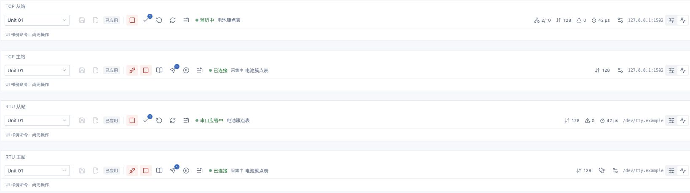
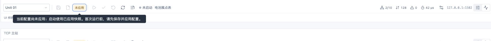

# 运行视图单行工具栏（2026-10-22）

## 变更

按用户确认的方案，将TCP／RTU主从站的单元上下文、保存／应用、运行操作、统计、设置、捕获初始值和视图切换合并为38px单行图标工具栏。`RuntimeToolbar`负责组合布局，`ToolbarIcon`／图标`ActionMenu`提供名称和hover／焦点提示，协议控制器继续持有动作、查询及对话框。

主站连接与周期采集仍是两个独立操作；手动读取、下发与回验、当前Unit暂停／恢复、串行诊断入口保留。从站启停、全Unit提交、地址范围／整Unit恢复、刷新和TCP连接上限入口保留。统计以图标和数字显示，说明在提示内，RTU不展示TCP连接数。待修改数量改为图标徽标。

未保存／未应用／待应用／已应用及引用模型未保存的说明放入状态提示，移除运行页常驻未应用横幅。不存在应用快照时启动／连接仍禁用；已有快照时待应用修改不额外阻止使用旧快照。保存、显式应用、启停、提交和回验语义未改变，运行表继续使用共用25px默认行高／表头。

实际错误继续显示为独立警报；本地操作错误和运行错误同时出现时去重并一起显示，避免本地提示覆盖运行失败。未确认结果即使没有错误正文也显示警报。可靠录制等待保留可见状态，详细说明可展开。

## 验证

- `pnpm --filter @essim/workbench test`：22个文件115项通过。新增3项覆盖首次应用／旧快照提示、保存与应用状态、模型未保存说明、真实错误／未确认结果及错误并存／去重。
- `pnpm --filter @essim/workbench build`：TypeScript及Vite生产构建通过，保留既有大于500kB包体提示。
- `git diff --check`通过。
- macOS Chrome `/runtime-toolbar.html`挂载真实主从站控制器，共四种角色／传输组合。该入口明确标注独立UI夹具，无协议后端；状态与命令响应均为样例，不进入生产入口。
- 四种运行栏实测均为38px。状态聚焦后展开未应用说明，页面没有未应用警报行；首次应用前从站启动和主站连接禁用。
- 待应用且存在快照：从站启动图标启用，夹具命令记录为`start → stop`；主站依次记录`connect → startPolling → stopPolling → disconnect`，连接后不会自行开始采集。
- 从站提交入口记录`setValues`并清除已提交数量徽标。主站手动读取菜单保留当前点／全Unit／地址范围；全Unit读取与下发记录`read`／`write`；当前Unit暂停后切为恢复图标；RTU串行诊断打开原有对话框。
- 错误夹具明确显示录制失败／请求超时；制造本地“没有待提交修改”后，真实运行错误和未确认结果仍同时可见。可靠录制等待夹具直接显示“等待录制”。
- 800px窄栏（内部可用798px）四种工具栏仍为38px；内容超宽时横向滚动，键盘聚焦TCP从站末尾运行页签后滚动位置为136.5px，末尾操作可达。地址不被挤成不可读的单字符。

## 边界

本轮是界面与组件交互验证；命令记录只证明按钮回调接入，不证明协议执行成功。未重验Tauri系统WebView、真实TCP／串口通信、硬件、可靠录制介质故障或规模性能，既有协议验收边界保持不变。UI夹具不提供保存／应用成功模拟；正式入口继续通过已有后端接口获取真实状态。
