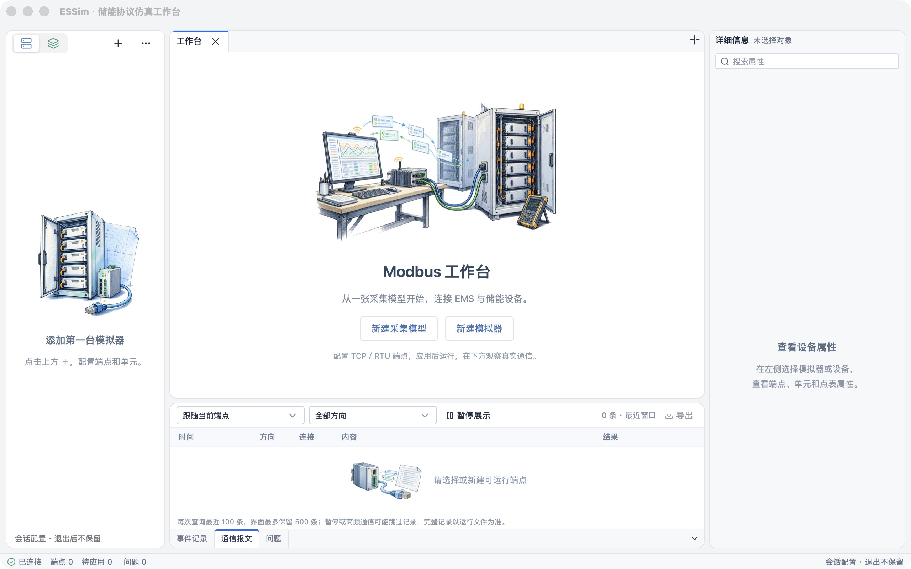
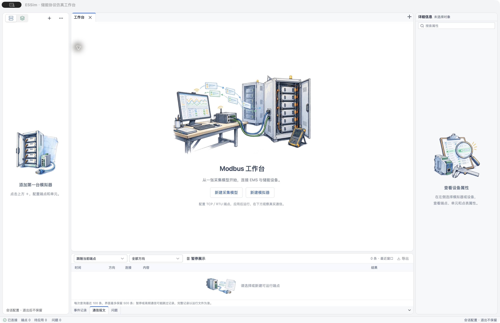

# 首开窗口尺寸与布局验证

用户要求重新评估首次打开时的宽高。原配置1440×980，左右栏固定288／310px；改为1280×800逻辑像素的首开目标，并在首次显示前适配显示器可用工作区、居中。左右栏和底部输出按初始视口比例分配，约束见[首开布局规范](../design/startup-layout.md)。

## 自动验证

- 先添加用例，实施后`pnpm --filter @essim/workbench test`：25文件121项通过，包含2项首屏布局用例。
- `cargo test -p essim-workbench --offline initial_window --lib`：4项通过，覆盖Retina逻辑像素换算、矮屏预留装饰空间、小工作区最小尺寸与负坐标副屏居中。
- `pnpm --filter @essim/workbench build`通过，保留既有大chunk提示。
- 本次涉及的窗口组装、配置和前端布局文件`git diff --check`通过。

## 原生验证

使用独立标识`dev.essim.startupcheck`构建`ESSim Startup Check.app`，直接使用已通过生产构建的前端资源：

```sh
pnpm --filter @essim/workbench tauri build --debug --bundles app --config '{"identifier":"dev.essim.startupcheck","productName":"ESSim Startup Check","build":{"beforeBuildCommand":null}}'
```

原生构建通过。在macOS系统WebView首次打开，真实配置核心已连接，目录为空；欢迎内容、操作按钮、底部通信报文和状态栏全部可见，通信报文保持默认选中。左右栏已收窄，中央区保留主要宽度。默认窗口截图为2560×1602物理像素；系统原生缩放后截图增至3358×2166，确认首开目标没有限制用户后续放大窗口。随后恢复并关闭独立验证窗口，没有创建设备或启动协议。





本轮未改协议逻辑，不重复运行全工作区协议测试。矮屏、Retina换算和负坐标副屏由几何用例覆盖；其他操作系统与实体多屏组合尚未实机复验。不新增窗口位置持久化，也不把首屏比例持续覆盖到用户手动布局。
