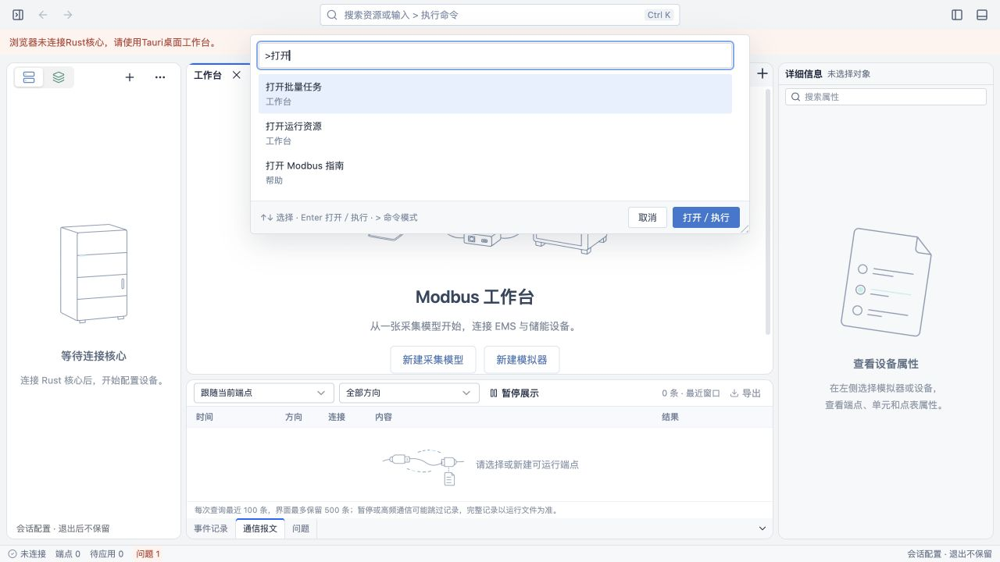
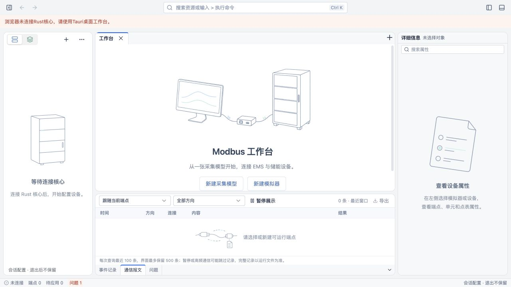
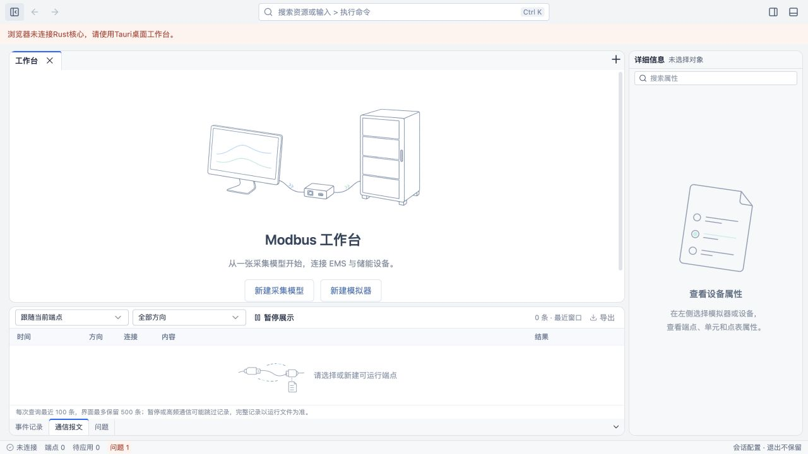
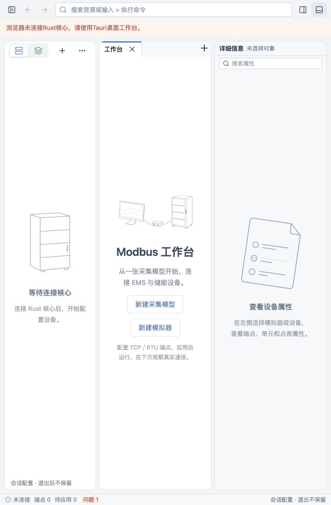

# 顶部检索与窗口栏实施记录

日期：2026-10-23。对应提案：[implement-workbench-command-center](../../openspec/changes/implement-workbench-command-center/proposal.md)。

## 实现范围

顶部使用统一高度的轻色栏，文档 Tabs 保留在中间 Dockview 内容区。顶部最左侧包含左侧导航面板开关和文档前后导航，中间为资源／命令检索，右侧提供属性与底部面板开关。资源索引按首次查询加载，支持中文、英文、拼音全拼、首字母和路径。前导 `>` 切换到轻量命令注册表；目前接入十条命令，并保留不可用状态。

检索复用公共 WorkbenchDialog 的 command 变体，从顶部展开，保留共享焦点限制、Esc、拖动与缩放机制；修复共享弹框捕获打开前焦点的时机。Windows/Linux 使用适配层窗口按钮，macOS 使用原生红绿灯与 Overlay；关闭仍经过原有退出保护。

## 自动检查

- `pnpm --filter @essim/ui typecheck`：通过。
- `pnpm --filter @essim/workbench test`：31 个文件、141 项测试通过。新增覆盖历史分支及失效目标、命令条件和路由、窗口适配与公共弹框变体。
- `pnpm --filter @essim/workbench build`：通过；Vite 仍报告应用 chunk 超过 500 kB，拼音索引已单独动态拆包。
- `cargo check -p essim-workbench --offline`：通过（当前 macOS）。
- `OPENSPEC_TELEMETRY=0 openspec validate implement-workbench-command-center --strict`：通过。
- `git diff --check`：通过。

## 浏览器实际检查

使用本机开发服务 `http://127.0.0.1:1430/`，没有连接 Rust 后端，不构造虚假设备或运行状态。

- 顶部入口打开弹层，输入框获得焦点；命令弹层从顶部展开，无暗色遮罩。
- 输入 `xiangxizhinan` 找到内置 Modbus 详细指南，Enter 打开真实文档。
- 输入 `>打开` 显示实际注册命令，打开指南后可前后导航到工作台；边界按钮禁用。
- 右侧属性面板开关可折叠／恢复面板。
- 后端不可用时，新建命令与执行按钮禁用。
- Ctrl+Shift+P 进入命令模式；Esc 关闭后焦点返回顶部入口。
- 输入框 Shift+Tab 到最后的缩放控件，再按 Tab 返回输入框，焦点未落到背景。

## 未验边界

补充外部点击关闭检查：command 变体在外部按下并释放时走共享取消入口，busy 保护继续生效。浏览器实际验证内部输入点击不关闭，点击外部关闭且焦点返回顶部入口。UI 与 workbench 类型检查、141 项测试通过；此项尚未在 Tauri WebView 重验。

用户解锁后，通过 `pnpm --filter @essim/workbench tauri build --debug --bundles app --config /private/tmp/essim-command-check.json` 成功生成并启动独立标识 `dev.essim.commandcheck` 的应用。未创建端点或启动协议通信。

已观察到：

- 原生 AX 中存在关闭、全屏／缩放和最小化按钮，顶部没有重复品牌标题。
- 点击全局检索可打开弹层，输入 `xiangxizhinan` 匹配 Modbus 详细指南；当前输入法同时出现组合候选。
- Esc 退出组合与弹层后，焦点返回顶部检索入口。
- 调用原生缩放动作后，截图从约 1280×800 逻辑尺寸变为更大窗口；顶部空白区双击后，截图恢复原尺寸，内容布局保持正常。

保留未验：

- 执行了顶部拖动动作，但窗口截图不含屏幕位置，未取得可复核的位移证据。
- 点击最小化后，工具继续返回旧 AX 内容；Raise 和重新获取应用没有恢复可交互状态，进一步连接 Dock 时原生自动化服务超时。因此最小化恢复、关闭按钮触发退出确认、取消退出及放弃退出的完整流程尚未验证。
- 以上英文拼音和组合候选证据不能替代完整中文输入法验证。

Windows/Linux 尚无目标平台运行证据，原生窗口按钮、拖动、贴靠、缩放和退出行为保持待验。浏览器证据不能代替 Tauri 平台验收。没有新增协议互操作或性能结论，提案暂不归档。

补充位置修正：最左侧图标改为控制左侧导航，并同步左侧面板图标和提示；右侧图标控制属性面板。workbench 类型检查通过。

补充折叠空间修正：左右 Dockview edge 的 collapsedSize 设置为 0，收起后不保留空白竖条，底部原有标签条保持。浏览器实际验证左侧收起无空白条且再次点击恢复导航；workbench 类型检查通过。

底部补充调整：使用 Dockview 公开 setEdgeGroupVisible 接口隐藏整个输出区域，避免标签实测高度覆盖 collapsedSize 而留下标签条。顶部图标及底部收起按钮复用同一布局命令。浏览器截图确认隐藏后中央内容延伸到底部，顶部可恢复，面板内收起按钮同样隐藏整个区域。workbench 类型检查通过。

