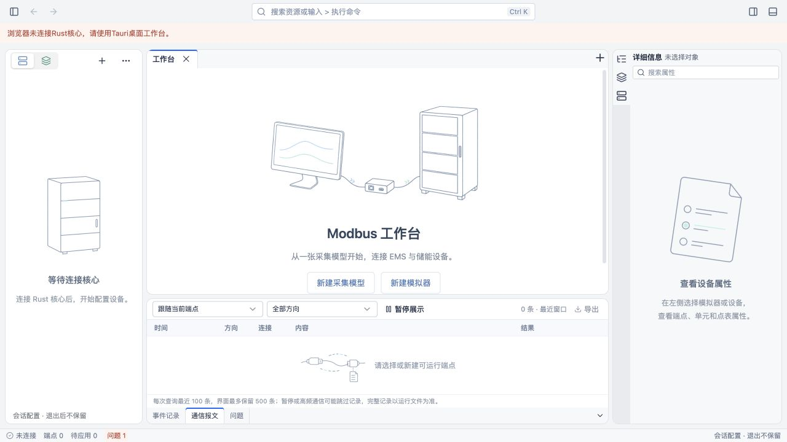
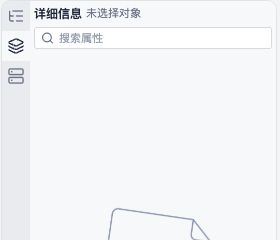
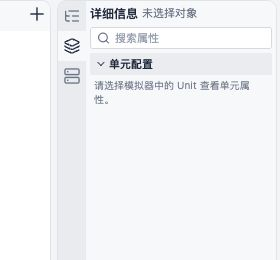
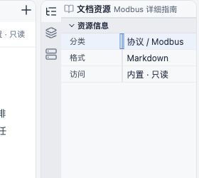

# 属性面板紧凑版实施与验证

日期：2026-10-23。[提案](../../openspec/changes/use-right-edge-inspector-tabs/proposal.md)及设计、规格、任务已同步修订，其他工作台布局保留。

## 实现

- 公共 PropertyPanel 新增可选 compact 密度，仅右侧属性区启用；标准密度保持。
- 右侧组左边的图标栏28px，行高30px。选中标签与内容同色、无分隔边、无蓝线和圆角块，未选中底色稍深；名称提示和键盘焦点继续由原生标签提供。
- 常规属性行22px、控件20px、分组头22px，组间距2px、内容留白4px。字段名右对齐，保留列宽调整命中区，长字段和复合控件按内容增高。
- 模型选中点分为点定义、数值解释、访问与采集；编码预览默认折叠。既有字段编辑回调、禁用条件、模型名称及引用未改；四遥分类与备注不重新显示。

## 检查结果

- UI 类型检查通过。
- workbench 构建（包含TypeScript检查）通过，仍有既有大chunk提示。
- 33个测试文件、144项测试通过。新增 ModelDetails 渲染回归检查：全部可见字段及列宽手柄保留、分组出现、编码预览默认折叠、无四遥分类和备注。
- OpenSpec严格校验通过，git diff --check通过。

实际浏览器使用本机1430开发服务，无Rust后端，未伪造业务数据。读取DOM与计算样式确认：

- 图标栏28px、图标行30px、头部24px。
- 选中标签和属性内容背景均为 rgb(247,248,250)，选中box-shadow为none，图标栏右边框0px。
- 切换点／端点及顶部收起恢复正常。
- 拖动右侧组至220px总宽时，属性内容190px，scrollWidth与clientWidth均190px，搜索无横向溢出。
- 截图恢复原面板宽度后保存，中央、左侧及底部布局保留。

## 未验范围

浏览器截图只证明空上下文中的图标、头部、搜索和布局。模型字段由组件渲染回归测试覆盖；真实数据输入、分组折叠后的编辑焦点、紧凑列宽拖动及Tauri WebView交互仍待连接后端复核。未新增协议、互操作或性能结论。

选中开口修复：Dockview 对 active／inactive group 的 hiddenpanel 背景规则覆盖了普通 CSS，导致未选中标签仍与内容同色。现补齐该组两种 hiddenpanel 主题变量为 #e8ebef。浏览器验证点／Unit切换及焦点回到中央文档后，仅选中标签为 #f7f8fa，其余两个为 #e8ebef。

图标范围内容修复：模型上下文原先在读取scope之前直接返回ModelDetails，导致三个图标重复显示模型点属性。现传入scope：点显示模型点属性，Unit／端点分别显示当前模型的关联对象入口（只取当前配置引用，端点去重）；没有关联时明确提示。设备／文档／未选中对象时，不适用的Unit／端点范围也显示各自空态，不再复制点属性。

新增模型范围回归用例后，33文件145测试及构建通过；浏览器无后端验证Unit显示单元配置、端点显示端点配置及对应选择提示。真实引用入口跳转与Tauri仍待带后端复核。

UE属性表风格恢复：用户反馈紧凑版误将Blender字段布局套入内容区。已恢复字段名左对齐、连续列分隔线、细行线及通栏分组，无组外边距；保留22px行高和外侧图标栏开口。UI类型检查、diff检查通过；本次样式恢复尚未做带后端的WebView复验。前述右对齐与弱网格描述为该次历史实现，不再是当前样式。

列宽拖动修复：拖动时改为面板层单个连续指示条，覆盖首至末可见字段，避免逐行线段在边框处断开。名称列取消向左的最小宽度，允许0；默认列宽和右侧值列约束保留，字段名缩小时省略而不逐字换行。

先修改列宽回归用例确认旧实现失败（10px被限制为112px），再调整JS/CSS约束。145项测试、UI类型检查及构建通过。浏览器使用内置Modbus文档的真实资源属性验证：拖动后三行名称列均约14.7px；Shift+左箭头后列宽及aria-valuenow均0；Home可恢复默认。截图为恢复后的状态。自动化工具的drag会立即释放，因此未捕获按住指针期间的指示条截图；单条指示条结构由实现及构建检查覆盖，Tauri拖动观感待复核。

