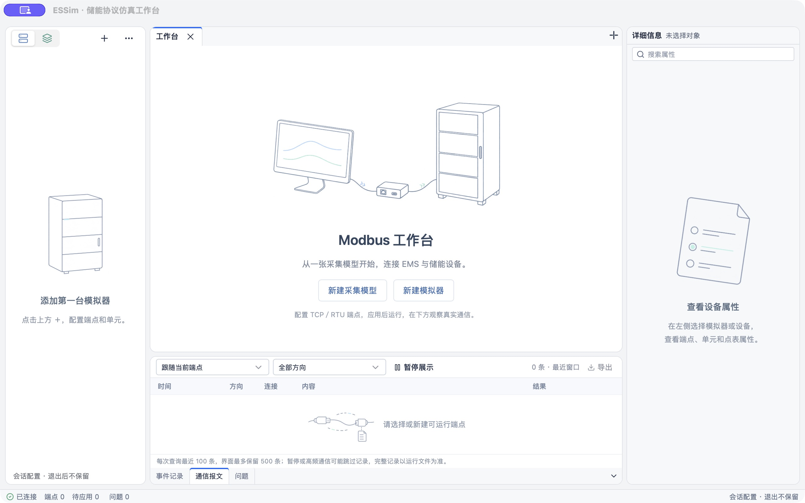
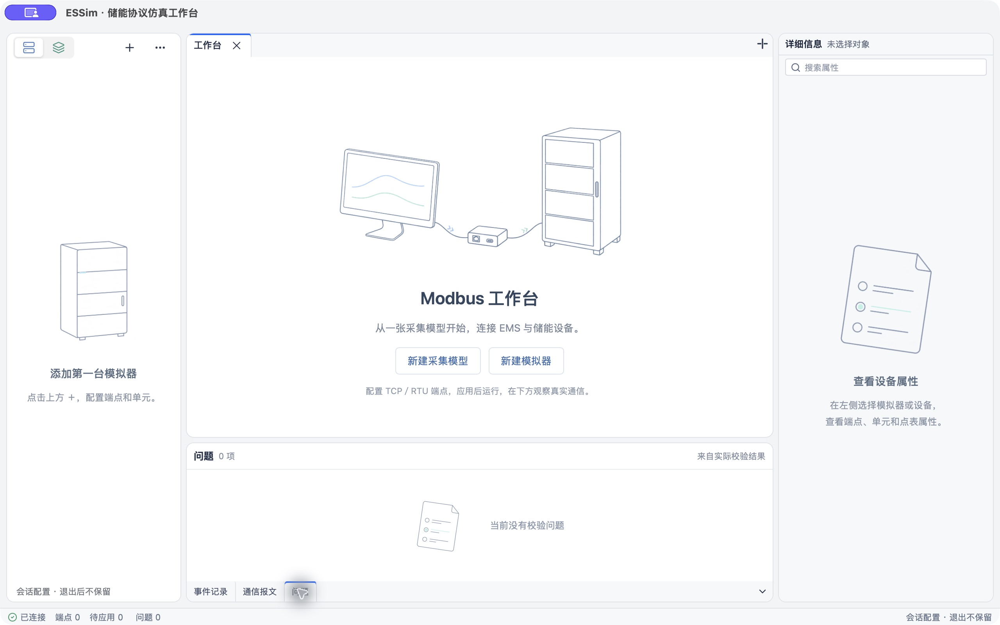
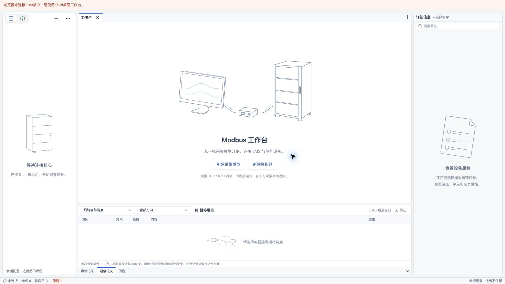

# 轻量工程线稿

用户反馈原插画整体偏重，确认采用细线、留白、少量浅色的方向。本轮重新生成四张透明素材并更新`WorkspaceIllustration`引用，保留既定尺寸和首开布局，不以CSS降低透明度或继续缩小旧图。

- 中央：电脑、网关、单个闭合机柜和一根连线，去掉桌面道具、额外机柜、金属排线与阴影。
- 模拟器空态：单个机柜轮廓与四层分区，去掉网关、底图纸和复杂接线。
- 属性／问题空态：单张点表、三行定义和简洁选中标记，去掉通信模块、卡尺与厚重放大镜。
- 事件／通信空态：接头、虚线路径和记录纸符号，去掉写实设备材质。

当前素材、实际尺寸及完整内置imagegen提示词见[素材说明](../../workbench/src/features/workspace/illustrations/README.md)。新素材以`-light.png`保存，旧版本仅作为设计迭代参考，生产入口不引用。图像轮廓以柔和灰色为主，少量浅蓝／浅绿点缀，保持透明底和空白内面。

## 验证

- `pnpm --filter @essim/workbench build`通过，四张新图作为带hash的本地资源打包，保留既有大chunk提示。
- 本轮涉及的入口文档与组件引用`git diff --check`通过。
- Chrome实际工作台复查四张资源加载完成；中央展示区域500×282px（高度随视口），侧栏各160×160px，底部110×74px。事件／通信标签切换保留原状态文字，未用图像制造在线或成功状态。
- 原生构建命令：`pnpm --filter @essim/workbench tauri build --debug --bundles app --config '{"identifier":"dev.essim.lightartcheck","productName":"ESSim Light Art Check","build":{"beforeBuildCommand":null}}'`，复用本轮已通过构建的前端资源，构建通过。
- macOS系统WebView独立验证窗口连接真实配置核心：白色与浅灰面板上的线稿清晰，未出现可见背景矩形或虚化光晕；默认通信报文和零问题空态均显示新图。验证后恢复通信标签并关闭独立窗口，没有创建设备或启动协议。

本次只替换插画素材与引用，没有改业务行为，不新增镜像样式测试，也未重复运行协议测试。其他操作系统、真实通信和规模性能不在本轮验证范围内。
