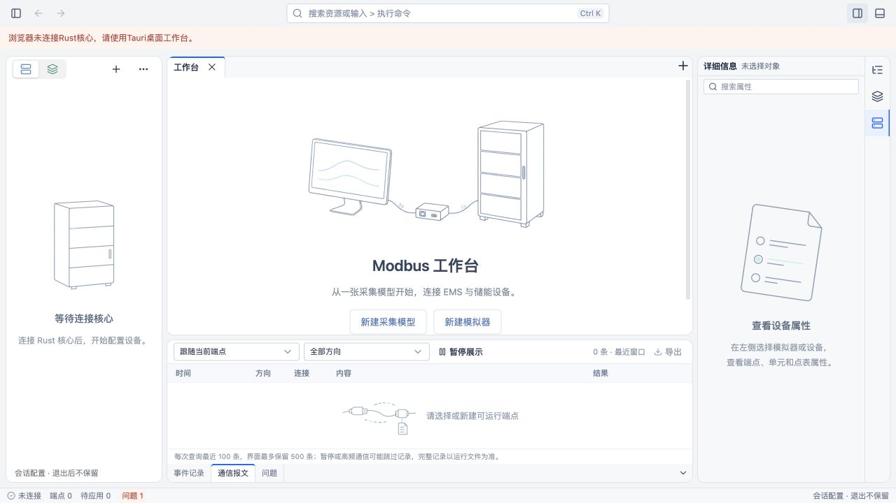

# 右边缘属性图标标签实施记录

日期：2026-10-23。对应[提案](../../openspec/changes/use-right-edge-inspector-tabs/proposal.md)。

## 变更

右侧 inspector-edge 使用 Dockview 8.5.1 的 `setHeaderPosition('right')`，包含点、Unit、端点三个稳定 ID 面板；默认 Unit。标签仅有 ListTree／Layers／Server 图标，无下方文字、无关闭按钮，title 和原生 tab 的 aria-label 保留名称。选中时浅蓝底、右侧蓝线。仅对该组覆盖竖栏样式，避免改变中央文档和底部标签。

各面板沿用共享 PropertyPanel，对应范围条件渲染并独立搜索；搜索状态在标签切换后保留。非端点上下文继续使用设备、模型及文档的已有属性。右面板顶部开关使用公开可见性接口完整隐藏／恢复，右侧范围不写入文档历史。校验定位按字段选择 Unit／端点面板，焦点只定位可见范围。

没有修改其他布局初始比例、协议核心、配置格式或保存／应用规则。没有建立新表单框架或添加依赖。

## 验证

- 修改前基线：31 个文件、141 项测试通过。
- 新增校验范围与历史面板识别测试，先确认缺少实现时失败；最终32个文件、143项通过。
- `pnpm --filter @essim/workbench typecheck`：通过。
- `pnpm --filter @essim/workbench build`：通过；Vite 应用 chunk 超过500 kB的提示仍存在。
- `OPENSPEC_TELEMETRY=0 openspec validate use-right-edge-inspector-tabs --strict`：通过。
- `git diff --check`：通过。

浏览器使用本机开发服务，没有连接 Rust 核心，没有构造设备或运行记录。实际检查：

1. 默认 Unit，三个原生 tab 的 aria-label 分别为点、Unit、端点，文本内容均为空，标签宽36px。
2. 点击点／Unit／端点后，原生 aria-selected 更新；方向键移动焦点、Enter激活，保留Dockview键盘行为。
3. Unit输入属性搜索词后切至端点再切回，搜索词保留且没有串入端点。
4. 连续切换后历史后退仍禁用，中央工作台、左导航及底部面板保留。
5. 顶部右面板图标隐藏整个右侧区域，中央区域扩展，无残留竖条；恢复后仍选中端点，总宽276px保持。
6. 原生主题选中底色会覆盖普通CSS，已改为该组局部主题变量，实际读取选中背景为浅蓝 `rgb(231, 240, 255)`。

## 边界

本轮无后端浏览器只能验证空上下文、标签、布局、搜索状态和历史行为。真实端点各范围字段编辑、选中运行点、草稿保存／应用、校验自动聚焦以及 Tauri WebView 实测仍待带后端环境复核；未把已有历史协议测试当作本轮UI验收。不新增协议互操作或性能结论。
