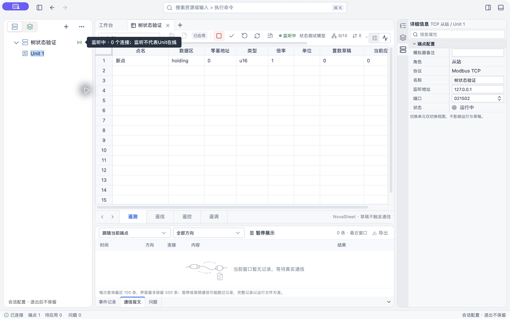
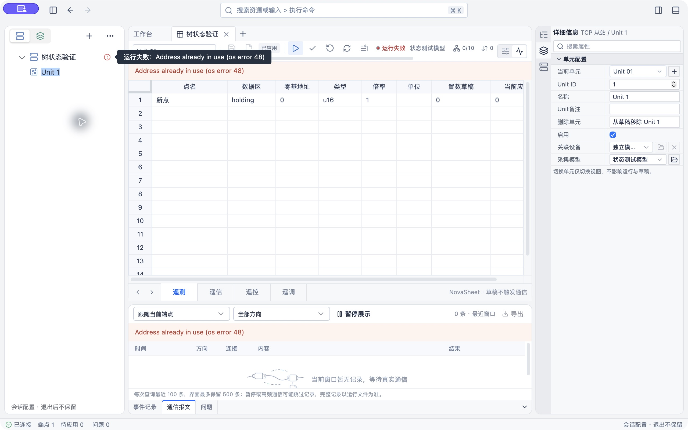

# 树节点状态实施与验证

## 变更

按确认设计，将运行状态及配置标记放在节点行最右侧，使用颜色和图标，hover说明真实状态。新增状态映射、可见节点元数据查询、Shadow DOM自有挂载层及已观察点质量记录；无新依赖，不改协议操作、配置保存／应用或其他工作台布局。

## 自动化

- `pnpm --filter @essim/workbench test`：38个文件、159项通过，覆盖状态映射、监听不推导Unit在线、未应用Unit不借用采集状态、故障原因、旧序号、查询失败、空点列表、4并发上限、取消后停止派发及忽略响应、已观察质量去重。
- `pnpm --filter @essim/workbench build`：TypeScript及Vite构建通过；仍有原有大包体积提示。
- `OPENSPEC_TELEMETRY=0 openspec validate show-resource-tree-status --strict`：通过。
- `git diff --check`：通过。

## macOS Tauri真实验证

使用独立identifier `dev.essim.treestatuscheck`、正式客户端与真实Rust核心，创建隔离测试端点“树状态验证”、模型“状态测试模型”及一个真实点；未修改用户原会话。没有注入假运行状态。

1. 创建后，端点最右侧灰色未启动与琥珀色待应用并列；正常从站Unit无在线标记。
2. 新增点并保存、应用后，待应用图标消失，原树及节点保留，未出现重复状态容器。
3. 首次使用127.0.0.1:1502启动时真实返回端口占用。树显示红色故障图标，hover显示`运行失败：Address already in use (os error 48)`。没有终止占用该端口的进程。
4. 隔离端点改为经检查空闲的127.0.0.1:21502，保存、应用、启动成功。树显示绿色监听图标，hover显示`监听中 · 0 个连接；监听不代表Unit在线`。
5. 停止测试从站，工具栏及树返回已停止，测试监听已释放；隔离测试会话保持停止。

## 边界

原生证据覆盖macOS TCP从站的未启动／待应用／应用／失败／监听／停止及hover。主站、RTU、禁用／暂停和质量映射由自动化覆盖相应逻辑，未逐一建立原生交互证据；未做Linux、Windows或规模性能验收。升级树组件需复核data-item-path及虚拟行适配，不将本次界面增强作为协议阶段整体验收。
