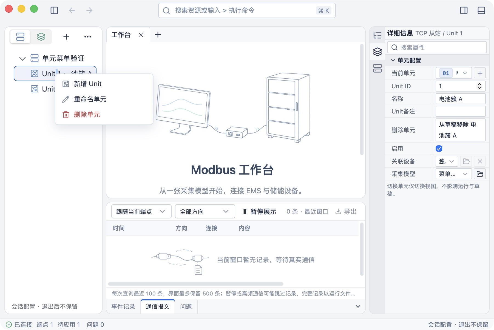
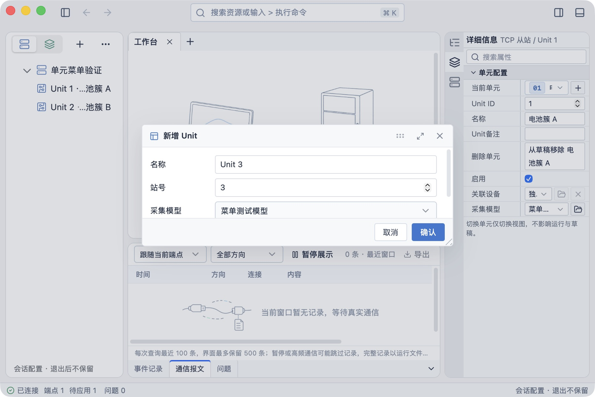
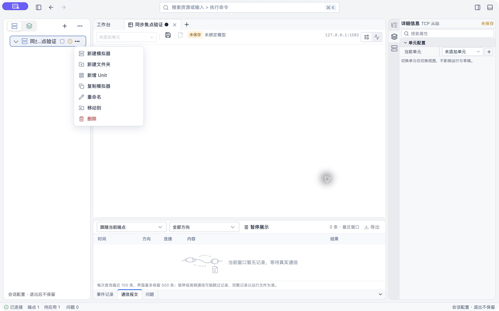
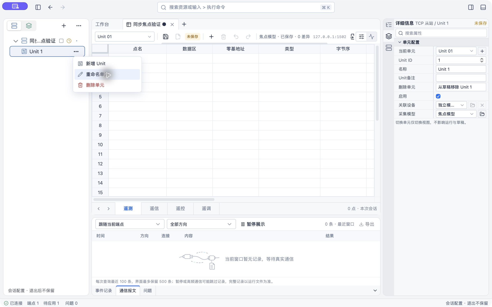

# Unit 树右键菜单修复与验证

## 变更

Unit 节点原本复用了 `kind: endpoint` 文档目标，菜单和导航弹框只检查 kind，忽略 unit 稳定 ID，导致重命名和删除作用于整个模拟器。本轮增加明确的单元菜单与草稿操作；导航弹框也拒绝将带 Unit 身份的请求降级为整机操作。

- Unit 菜单：新增 Unit、重命名单元、删除单元。模拟器节点保留新建、复制、重命名、移动、删除，并补新增 Unit。
- 设备树中的 Unit 引用使用相同单元操作。新增选择站号及已有采集模型，默认建议最小空闲站号；拒绝重复／非法站号、缺失模型及 RTU 从站第二个 Unit。
- 单元结构修改只编辑所属模拟器草稿，保留其他单元、模型、设备和应用快照。确认删除会丢弃该单元的点表编辑草稿；删除当前单元后转向剩余单元，允许保留空模拟器。
- 树即时反映模拟器／单元草稿名称和结构。保存、应用仍分开，协议执行和整机删除命令未修改。
- 树右键菜单统一左侧图标、紧凑对齐及删除警示色，移除文字末尾省略号。导航弹框统一 form 提交及取消按钮类型，复用公共 WorkbenchDialog。

## 自动化

- 先新增回归用例，确认缺少单元操作实现时报错，再实现修复。
- `pnpm --filter @essim/workbench test`：39 个文件、165 项通过。新增 6 项覆盖菜单作用范围、保留兄弟单元及现有草稿、保存与应用快照隔离、新身份、新增校验、失效目标、选择回退及最后一个单元删除。
- `pnpm --filter @essim/workbench build`：TypeScript 与 Vite 构建通过；保留原有大包体积提示。
- `git diff --check`：通过。

## macOS Tauri 验证

使用独立标识 `dev.essim.unitmenucheck` 的正式工作台与真实 Rust 核心创建测试端点“单元菜单验证”和空模型“菜单测试模型”，没有修改用户原会话，也没有启动协议监听。

1. Unit 右键仅出现三个单元操作，各有图标，无文字末尾省略号；模拟器菜单保留整机操作。
2. 将 Unit 1 改为“电池簇 A”，树和属性栏立即同步，模拟器名称仍为“单元菜单验证”，显示未保存。
3. 从 Unit 菜单新增“电池簇 B”：默认站号 2，重复站号 1 被拒绝并保留输入；改回 2 后新增成功。两个单元同时存在，保存成功。
4. 删除“电池簇 B”只将它从草稿移除，端点数量仍为 1，“电池簇 A”保留并成为当前单元。
5. 初始输入焦点、Enter 提交、Tab／Shift+Tab 限制在弹框内、Esc 取消均检查。窄窗口约 901×602 逻辑像素，检查标题栏拖动、角落缩放、键盘缩放、复位、滚动区与固定按钮可见。
6. 首轮关闭后的连续方向键及 Shift+F10 未获得稳定结果，当时保留待复核；后续修复与原生验收见下节。

## 边界

新增单元使用已有模型；没有新增模型版本或自动应用。RTU 单元数量和容量限制由自动化覆盖，未做 RTU 硬件、Windows／Linux 或协议互操作验收。复制／移动／整机删除的后端行为未改变，本轮没有重新执行整机删除。导航弹框的 busy 保护继续复用公共组件及按钮禁用，未注入长延迟请求验证忙碌关闭。

## 后续：关闭弹框后的键盘焦点修复

修复内容：原实现保存旧树路径并通过双层 `requestAnimationFrame` 等待焦点恢复；重命名后路径失效，动画帧未执行时恢复动作也不会发生。现在由公共 WorkbenchDialog 先关闭原生 modal、解除背景 inert，再调用业务传入的 `restoreFocus`；回调固定在这次导航请求中，树组件使用最新投影和稳定 ID 同步解析目标、更新键盘游标、展开祖先并滚动。已挂载行直接聚焦；删除后回退到所属模拟器／原父目录，空树回退到导航面板。恢复动作不依赖动画帧，也不触发配置保存或应用。

验证结果：

- `pnpm --filter @essim/workbench test`：41 个文件、173 项通过。新增 8 项覆盖 modal 关闭与 focus 的先后顺序、普通弹框兼容、重命名路径、删除祖先回退、同名新对象隔离、设备引用树、400 个子节点的展开与滚动，以及 DOM 焦点与键盘游标一致性。
- `pnpm --filter @essim/workbench build`：TypeScript 与 Vite 通过，保留原有大包体积提示。
- `pnpm --filter @essim/workbench tauri build --debug --bundles app --config /private/tmp/essim-focus-verified.json`：正式客户端打包通过。临时配置只覆盖测试产品名、唯一标识 `dev.essim.focusverified`、关闭重复前置构建及开启 app bundle；未改产品配置。
- 原生环境为 macOS Tauri、真实 Rust 会话；创建端点“同步焦点验证”和空模型“焦点模型”，没有启动通信。测试应用使用唯一安装路径，显式激活窗口后检查。
- Esc 关闭 Unit 重命名弹框后，连续 `Up → Down → Shift+F10` 打开 Unit 菜单，无中间鼠标点击。
- 确认重命名为“电池簇 A”后，直接 `Shift+F10` 打开同一 Unit 的菜单；随后点击取消，再按 `Shift+F10` 仍为该 Unit 菜单。
- 确认删除唯一 Unit 后，直接 `Shift+F10` 打开所属模拟器菜单；原生 AX 明确报告焦点为“同步焦点验证”，端点仍存在。
- 从该菜单新增 Unit 后，连续 `Down → Shift+F10` 打开新 Unit 菜单。最后再次复核 Esc 与双向方向键闭环通过。

[原生键盘证据](assets/unit-dialog-focus/native-keyboard.txt)保留改名／取消后 Unit 菜单及最终 Esc 闭环的 AX 状态。

此处原生验收覆盖单元新增、重命名、删除和取消的焦点路径；大虚拟树滚动、设备引用树与更高层目录回退由自动化覆盖，未重新验收其他平台及全部业务弹框。
